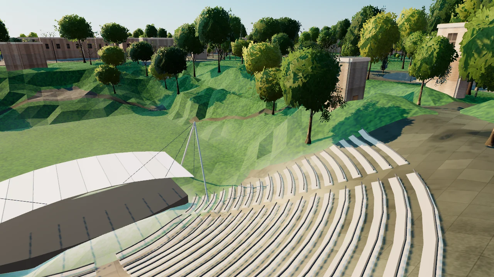
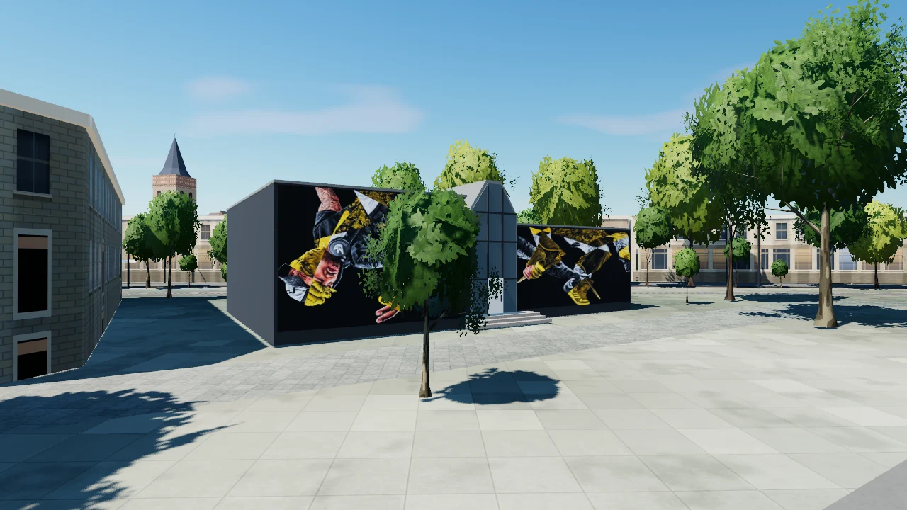
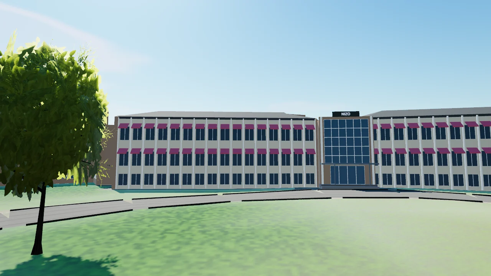

# Ede in 3D

Explore Ede, the Netherlands, in a 3D browser game built around its real streets, landscapes and landmarks. Wander from Oude Kerk to Marktplein, cycle out to Huis Kernhem, watch the Valleilijn trains at Lunteren, or fly a helicopter over the ENKA factory.

**[Play Ede in 3D](https://rolandsmeenk.github.io/ede-in-3d/)**

## Find your way around Ede

- **Walk the town centre.** Explore the shops and squares around Grotestraat, see Cultura and Raadhuis Ede, and look for street art at Astrant and the Van Eekelenflat.
- **Cycle or drive across town.** Follow mapped cycle routes, pass buses on local streets, and watch the trains at Ede-Wageningen, Ede Centrum and Lunteren.
- **Jump to a major area or find a landmark.** Use **Teleport** for areas such as Centrum, ENKA, Ginkelse Heide and Lunteren. Open **Map** and search for an individual landmark, such as De Eder Kuil, Groot Zonneoord or De Valenberg, then click its pin to teleport.

## Ede by the numbers

| Feature | Count or coverage |
| --- | ---: |
| Map extent | 16.4 × 11.5 km |
| Teleport menu areas | 14 |
| Custom landmark models | 252 |
| Building footprints in the base map | 44,844 |
| Street litter bins | 555 |
| Waste collection sites | 395 |
| Mapped playground outlines | 119 |
| Municipal play-site locations | 218 |
| Playgrounds with surveyed equipment | 2 |
| Outdoor sports pitches, courts and tracks | 169 |
| Mapped traffic-light locations | 251 |
| Lamp posts | 15,241 |
| Mapped tree records in the default inventory | 70,124 |
| Trees placed in the default map | 185,045 |
| Mapped roads and paths | 2,583 km |
| Mapped railway tracks | 45 km |
| Modeled parking spaces | 18,193 |

Counts come from the bundled map, placement assets and landmark registry. The landmark total includes 248 registered sites, Ede-Wageningen station, the Sherman Tank monument and the two Chico and Chica sculptures. The placed tree total includes procedural woodland and estimated stems from the northern canopy survey. It counts trees after clearance checks. Municipal play-site points can overlap mapped playground outlines. Each traffic-light location is a mapped signal point, and each waste collection site counts as one placement even if it serves several waste streams. Lengths sum the mapped ways, including separate carriageways and parallel tracks. [Map data and sources](docs/map-and-assets.md)

## Screenshots

| ENKA Westhal and Poortgebouw | Station Ede-Wageningen | Huis Kernhem |
| --- | --- | --- |
|  |  |  |

| Kasteel Hoekelum | De Eder Kuil | Lukkien’s rooftop helideck |
| --- | --- | --- |
|  |  |  |

| Noorderkerk | Astrant mural | NIZO Food Research |
| --- | --- | --- |
|  |  |  |

[Browse the landmark screenshot gallery](docs/landmarks.md).

[See the in-game prop gallery](docs/map-and-assets.md#in-game-prop-gallery) for road signs, traffic lights, sports grounds, fuel stations, bins, and transformer houses.

## See Ede in a different light

Choose Golden Hour, Midday, Blue Hour or Night, or switch to **Live Time** to follow the sun in Ede. Turn on **Live Weather** with any lighting setting to bring in local clouds, rain, snow or fog.

## Documentation

- [Run locally or host the game](docs/running.md) including what works live on GitHub Pages, feed-server requirements, and profiling.
- [How the simulation works](docs/simulation.md) including weather, road traffic, bus and train timetables, and parking.
- [Map sources and asset builds](docs/map-and-assets.md) including rebuild commands, landmark references, and data attribution.

## Make it your own

Fork it, remix it, or use it to make a game, animation, film or experiment. Explore other cities in [Slop Cities](https://github.com/zz85/slop-cities).

Ede in 3D is forked from [Slop Utrecht](https://github.com/bertt/slop-utrecht), based on [Slop New York](https://github.com/mrdoob/slop-newyork). The code is available under the [MIT License](LICENSE). See [License and data](docs/map-and-assets.md#license-and-data) for map and imagery credits.
