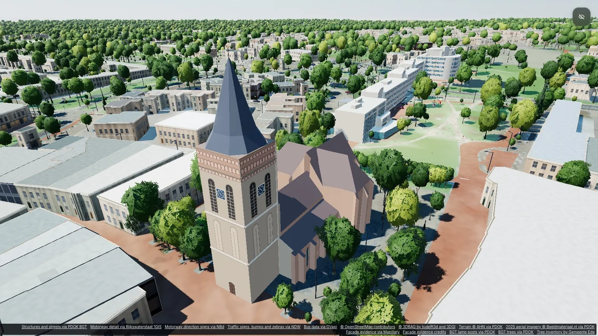

# Slop Ede

Explore Ede, the Netherlands, in a 3D browser game built around its real streets, landscapes and landmarks. Wander from Oude Kerk to Marktplein, cycle out to Huis Kernhem, or fly a helicopter over the ENKA factory.

**[Play Slop Ede](https://rolandsmeenk.github.io/slop-ede/)**

## Find your way around Ede

- **Walk the town centre.** Explore the shops and squares around Grotestraat, see Cultura and Raadhuis Ede, and look for street art at Astrant and the Van Eekelenflat.
- **Cycle or drive across town.** Follow mapped cycle routes, pass buses on local streets, and watch the trains at Ede-Wageningen and Ede Centrum.
- **Take off or jump straight to a landmark.** Fly over Ede or use the **Teleport** menu to visit the ENKA factory, Johan Willem Friso-kazerne, Openluchttheater Ede, and more.

| ENKA Westhal and Poortgebouw | Station Ede-Wageningen | Huis Kernhem |
| --- | --- | --- |
|  |  |  |

## See Ede in a different light

Choose Golden Hour, Midday, Blue Hour or Night, or switch to **Live Time** to follow the sun in Ede. Turn on **Live Weather** with any lighting setting to bring in local clouds, rain, snow or fog.

## Documentation

- [Run locally or host the game](docs/running.md) including what works live on GitHub Pages, feed-server requirements, and profiling.
- [How the simulation works](docs/simulation.md) including weather, road traffic, bus and train timetables, and parking.
- [Map sources and asset builds](docs/map-and-assets.md) including rebuild commands, landmark references, and data attribution.

## Make it your own

Fork it, remix it, or use it to make a game, animation, film or experiment. Explore other cities in [Slop Cities](https://github.com/zz85/slop-cities).

Slop Ede is forked from [Slop Utrecht](https://github.com/bertt/slop-utrecht), based on [Slop New York](https://github.com/mrdoob/slop-newyork). The code is available under the [MIT License](LICENSE). See [License and data](docs/map-and-assets.md#license-and-data) for map and imagery credits.
