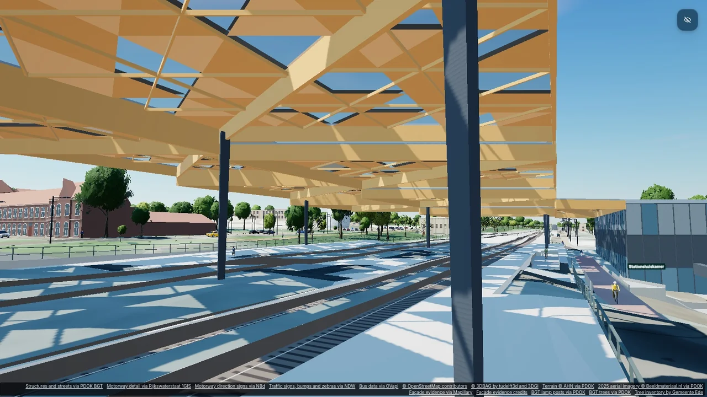
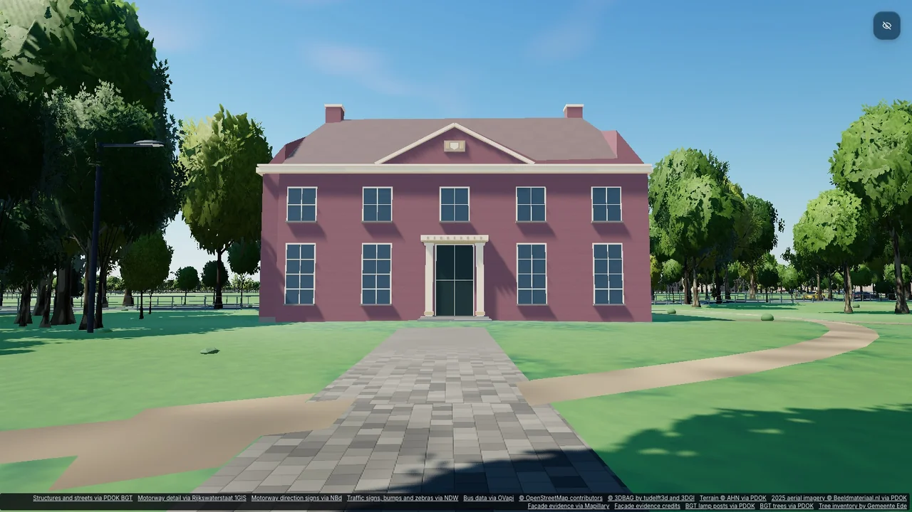
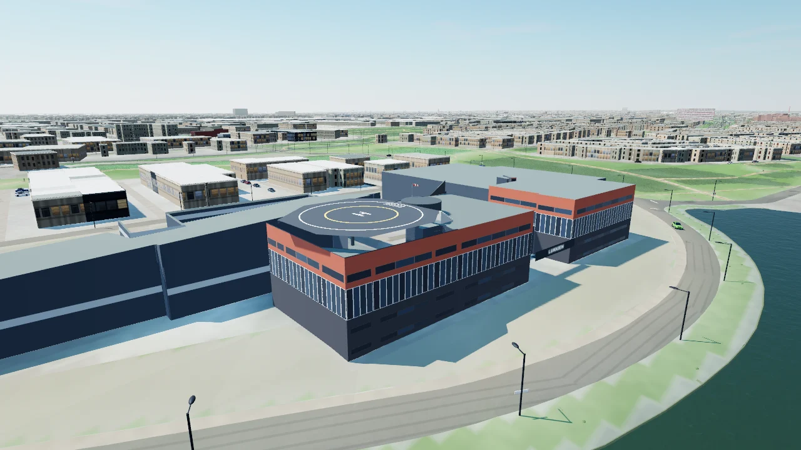
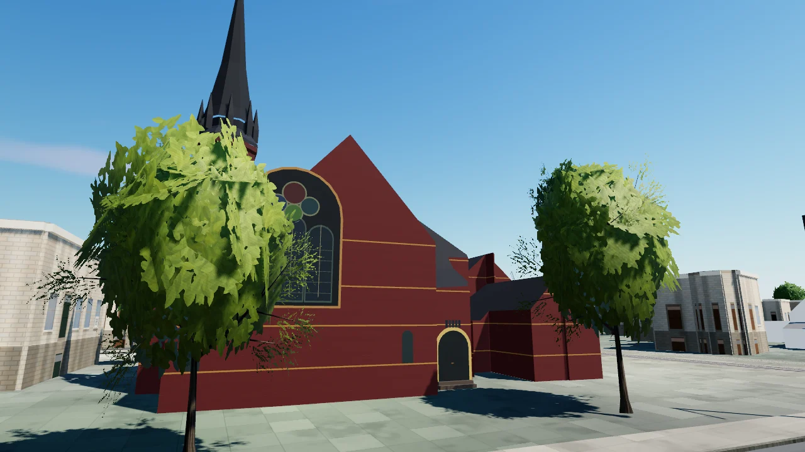

# Ede in 3D

Explore Ede, the Netherlands, in a 3D browser game built around its real streets, landscapes and landmarks. Wander from Oude Kerk to Marktplein, cycle out to Huis Kernhem, watch the Valleilijn trains at Lunteren, or fly a helicopter over the ENKA factory.

**[Play Ede in 3D](https://rolandsmeenk.github.io/ede-in-3d/)**

## Find your way around Ede

- **Walk the town centre.** Explore the shops and squares around Grotestraat, see Cultura and Raadhuis Ede, and look for street art at Astrant and the Van Eekelenflat.
- **Cycle or drive across town.** Follow mapped cycle routes, pass buses on local streets, and watch the trains at Ede-Wageningen, Ede Centrum and Lunteren.
- **Jump to a major area or find a landmark.** Use **Teleport** for areas such as Centrum, ENKA, Ginkelse Heide and Lunteren. Open **Map** and search for an individual landmark, such as De Eder Kuil, Groot Zonneoord or De Valenberg, then click its pin to teleport.

A border warning appears while you walk, cycle, drive or fly in the 500 m strip outside the municipality. The atlas marks the official boundary and the outer travel limit.

## Ede by the numbers

| Feature | Count or coverage |
| --- | ---: |
| Official area of Gemeente Ede | 318.62 km² |
| Playable area with the 500 m border | 361.15 km² |
| Exterior terrain and canopy | 2 km buffer |
| Gray BAG buildings in the 500 m buffer | 10,459 |
| Teleport menu areas | 14 |
| Custom landmark models | 258 |
| Mapped building footprints | 85,395 |
| Municipal litter-bin placements | 742 |
| Municipal waste container placements | 483 |
| Municipal play-site locations | 287 |
| Playgrounds with surveyed equipment | 2 |
| Outdoor sports pitches, courts and tracks | 396 |
| Timetable bus-stop records | 339 |
| Mapped traffic-light locations | 314 |
| Lamp posts | 22,902 |
| Mapped tree records in the default inventory | 127,213 |
| Mapped roads and paths | 3,672 km |
| Mapped railway tracks | 40 km |
| Modeled parking spaces | 26,543 |

Counts come from the bundled map, placement assets and landmark registry. The landmark total includes 254 registered sites, Ede-Wageningen station, the Sherman Tank monument and the two Chico and Chica sculptures. The tree inventory counts imported trunks before clearance checks and procedural woodland. Municipal play-site points can overlap mapped playground outlines. Each traffic-light location is a mapped signal point, and each waste collection site counts as one placement even if it serves several waste streams. Lengths sum the mapped ways, including separate carriageways and parallel tracks. [Municipal coverage and sources](docs/map-and-assets.md#municipal-coverage)

Bus-stop signs combine timetable records that share a boarding point. Shelter placements use mapped and surveyed sources. [Bus-stop models and sources](docs/map-and-assets.md#bus-stop-design-references)

### Outdoor sports areas by type

The expanded map adds 134 outdoor sports areas to the previous inventory. Mapped grounds include both sport-specific layouts and playing surfaces.

| Sport or use | Mapped areas | Sport or use | Mapped areas |
| --- | ---: | --- | ---: |
| Equestrian | 159 | Baseball and softball | 3 |
| Football | 89 | Field hockey | 3 |
| Tennis | 67 | Padel | 3 |
| Basketball | 25 | Korfball | 6 |
| Athletics | 19 | Pickleball | 2 |
| Table tennis | 5 | Boules | 2 |
| Multi-sport | 4 | Ice skating | 1 |
| Skateboarding | 6 | Unspecified | 3 |

Four courts count toward both football and basketball. [Bundled sports inventory](assets/ede-sports.json)

## Screenshots

| ENKA Westhal and Poortgebouw | Station Ede-Wageningen | Huis Kernhem |
| --- | --- | --- |
|  |  |  |

| Kasteel Hoekelum | De Eder Kuil | Lukkien’s rooftop helideck |
| --- | --- | --- |
|  |  |  |

| Noorderkerk | Astrant mural | NIZO Food Research |
| --- | --- | --- |
|  |  |  |

[Browse the landmark screenshot gallery](docs/landmarks.md).

[See the in-game prop gallery](docs/map-and-assets.md#in-game-prop-gallery) for road signs, traffic lights, sports grounds, fuel stations, bins, and transformer houses.

## See Ede in a different light

Open **Environment** and choose **Live** to follow Ede’s local clock, seasons, weather and Frankeneng water levels. In **Preset**, set the time of day, season and weather yourself. Try a windy autumn rain, a snowy winter night or summer on the purple heath. [Environment and data sources](docs/simulation.md#environment)

## Documentation

- [Run locally or host the game](docs/running.md) including what works live on GitHub Pages, feed-server requirements, and profiling.
- [How the simulation works](docs/simulation.md) including weather, road traffic, bus and train timetables, and parking.
- [Map sources and asset builds](docs/map-and-assets.md) including rebuild commands, landmark references, and data attribution.

## Make it your own

Fork it, remix it, or use it to make a game, animation, film or experiment. Explore other cities in [Slop Cities](https://github.com/zz85/slop-cities).

Ede in 3D is forked from [Slop Utrecht](https://github.com/bertt/slop-utrecht), based on [Slop New York](https://github.com/mrdoob/slop-newyork). The code is available under the [MIT License](LICENSE). See [License and data](docs/map-and-assets.md#license-and-data) for map and imagery credits.
