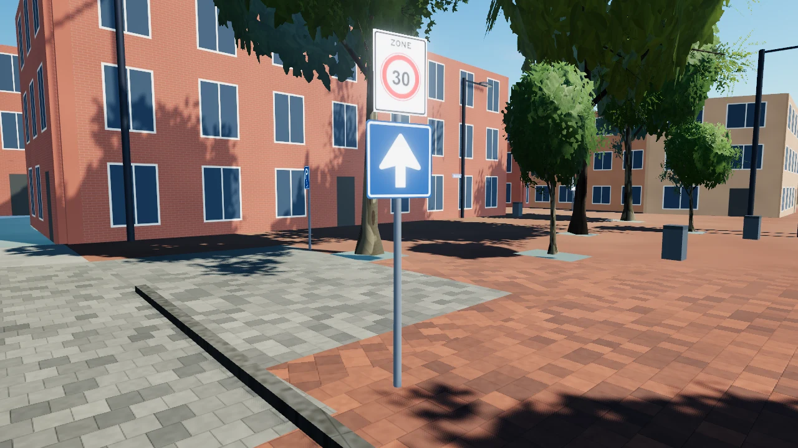
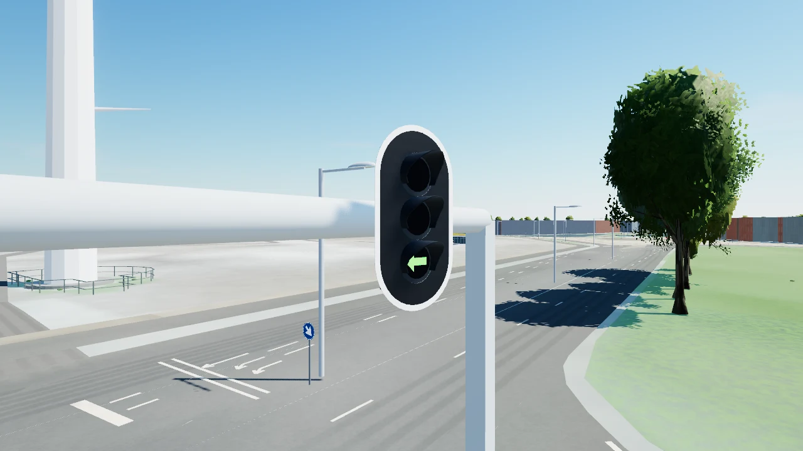
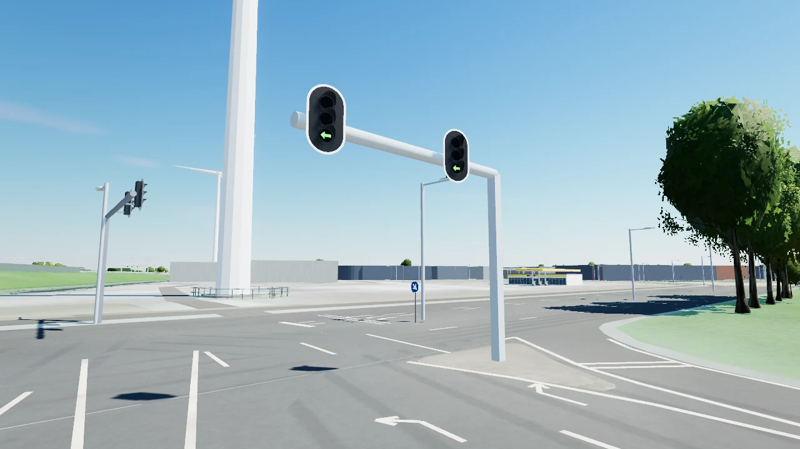
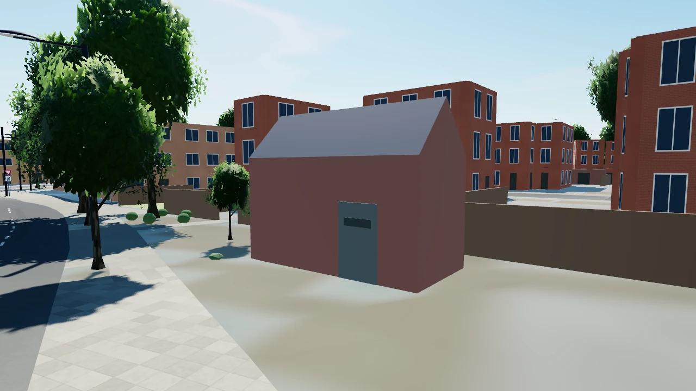
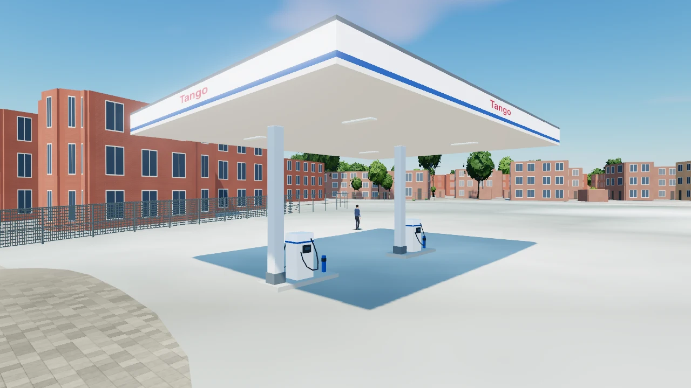
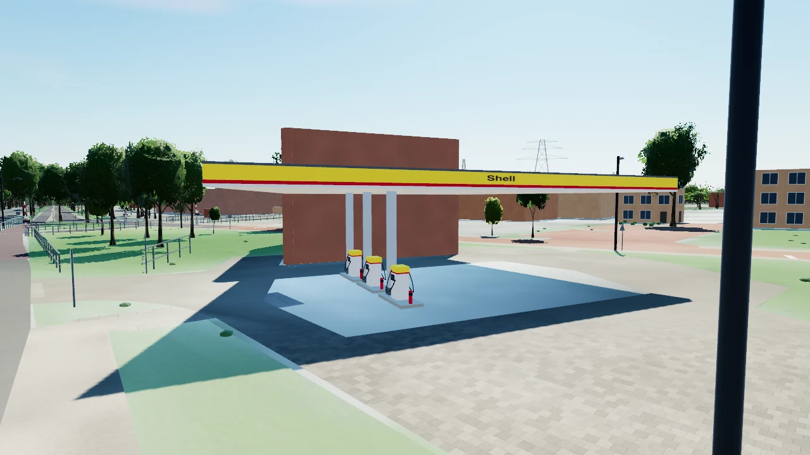
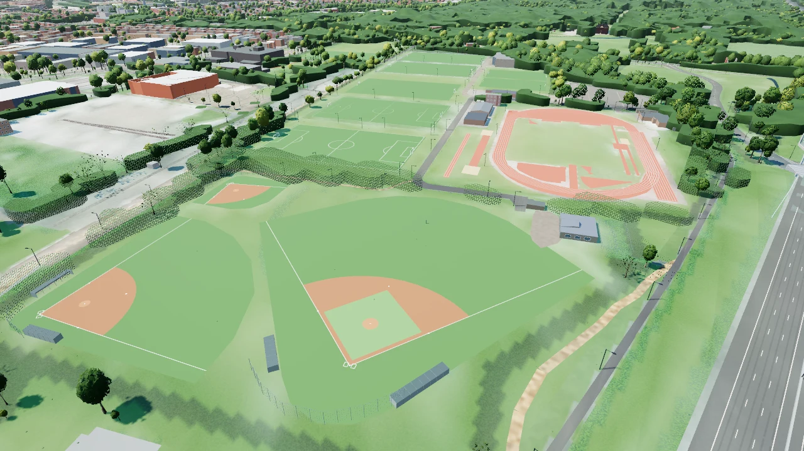
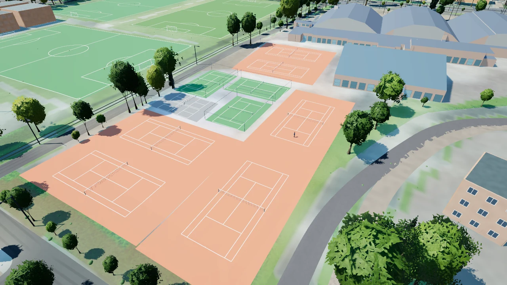
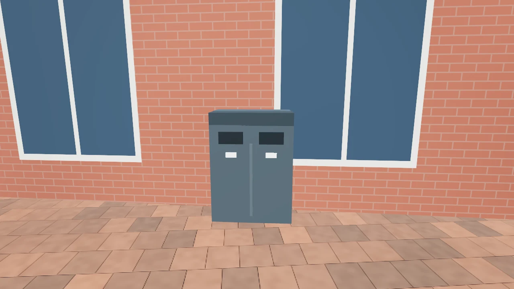
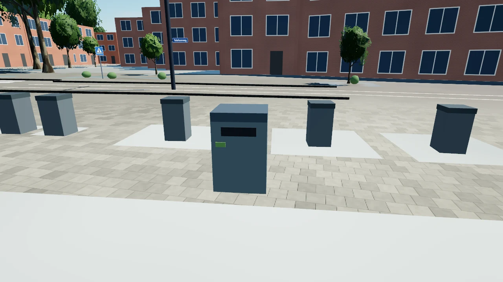

# Map, assets and data

Run the rebuild commands from the repository root. [Map and terrain](#refresh-the-ede-map) · [Roads and markings](#refresh-road-materials-and-lanes) · [Buildings and landmarks](#landmarks) · [License and data](#license-and-data)

## Data sources at a glance

Most map layers are built offline and bundled with the game. Nearby 3DBAG tiles stream when available, with local building footprints as a fallback. Optional live feeds update traffic, public transport, parking and weather.

| Layer | What it contributes | Sources |
| --- | --- | --- |
| Base map and routing | Street and path connections, parks, waterways, tracks and fallback building footprints | [OpenStreetMap contributors](https://www.openstreetmap.org/copyright) |
| Terrain and surface colours | Ground elevations, local height checks and colour samples for roofs, roads and land cover | [AHN via PDOK](https://www.ahn.nl/dataroom) · [2025 aerial imagery via PDOK](https://nationaalgeoregister.nl/geonetwork/srv/metadata/7b424340-25c5-4c95-8dbf-bf1d87888566) |
| Forest canopies | Distant woodland crowns and their measured relief | [Friedenau Society](https://www.friedenau.eu/praktijkvoorbeelden/boomkroonbedekkingskaart-voor-nederland) · [Klimaateffectatlas, CC BY 4.0](https://www.klimaateffectatlas.nl/nl/boomkroonbedekking) |
| Buildings and façades | LoD 2.2 building shapes, offline façade measurements and neighbourhood profiles | [3DBAG](https://docs.3dbag.nl/en/) · [Façade evidence credits](../assets/ede-facades.SOURCES.md) · [CBS neighbourhood boundaries](https://www.cbs.nl/nl-nl/dossier/nederland-regionaal/geografische-data/wijk-en-buurtkaart-2025) |
| Street art | Wall assignments, real-reference paint decals and two approved painted reconstructions | [Mural sources and wall assignments](../tools/data/ede-murals.md) |
| Streets and greenery | Surveyed road surfaces, bridges, platforms, shorelines, street furniture, lamps and trees | [PDOK BGT](https://www.pdok.nl/introductie/-/article/basisregistratie-grootschalige-topografie-bgt-) · [Municipal tree inventory](https://data.overheid.nl/dataset/39339aa2-a7dc-4f52-bcdb-f1eff423b69f) |
| Water works | Fixed and adjustable weirs | [Waterschappen Kunstwerken IMWA](https://www.pdok.nl/ogc-apis/-/article/waterschappen-kunstwerken-imwa) · [Waterschappen Oppervlaktewateren IMWA](https://www.pdok.nl/ogc-apis/-/article/waterschappen-oppervlaktewateren-imwa) |
| Motorways and traffic rules | Road sections, lane counts, infrastructure, access restrictions, signs, speed bumps and crossings | [Rijkswaterstaat 1GIS](https://geo.rijkswaterstaat.nl/arcgis/rest/services/GDR/geografische_areaalregistratie/MapServer) · [NWB and WEGGEG](../tools/data/ede-motorway-lanes.sources.md) · [NDW and WKD](../tools/data/ede-traffic-sources.md) · [NBd direction signs](https://downloads.rijkswaterstaatdata.nl/bewegwijzering/) |
| Rail and buses | Rail alignment checks, local timetables, boarding points and live service updates | [ProRail Basiskaart](https://maps.prorail.nl/arcgis/rest/services/ProRail_basiskaart/FeatureServer) · [OVapi](https://gtfs.ovapi.nl/nl/) · [NDOV](https://govi.nu/realtime.html) · [RRReis Ede](https://www.rrreis.nl/reisinformatie/haltes-dienstverlening/dienstregeling-bus/regio-ede) |
| Bus shelters | Stop locations, shelter and advertising flags, and representative shelter designs | [Gelderland stop register](https://geoportaal.gelderland.nl/gisserver/rest/services/Infra/Infra/MapServer/123) · [Ede shelter specifications](https://documenten.open.ede.nl/index.php/s/LGQLWcTMggkTp7n) |
| Live conditions | Road speeds and closures, authorised garage occupancy feeds and local weather | [NDW live traffic](https://opendata.ndw.nu/) · [Nationaal Parkeer Register](https://www.nationaalparkeerregister.nl/downloads/certificaten-en-aanvraagformulieren) · [Open-Meteo](https://open-meteo.com/en/docs) |

See [License and data](#license-and-data) for attribution and the sections below for refresh commands.

## In-game prop gallery

These daytime renders show reusable models at their mapped locations in Ede in 3D.

| Road signs on Molenstraat | Traffic signal backplate |
| --- | --- |
|  |  |

| Traffic-light cantilever at Galvanistraat | Transformer house |
| --- | --- |
|  |  |

| Tango on Molenstraat | Shell on Rijksweg |
| --- | --- |
|  |  |

| Moorfielders and Climax sports grounds | Tesqua courts |
| --- | --- |
|  |  |

| Street litter bin | Waste collection at Kuiperplein |
| --- | --- |
|  |  |

See [License and data](#license-and-data) for the sources shown in the renders.

### Bus shelters and the Bezoek Ede campaign

`python3 tools/build-ede-bus-shelters.py` bakes the active shelter flags, coordinates, bearings and seat flags for Ede from the Gelderland stop register. The November 2026 result has 96 records, including 84 flagged for advertising. The game uses the boarding direction and checks candidate footprints against the playable area, water, mapped buildings and motor and cycle paving. The current map fits 62 shelters, with advertising on 57. One surveyed BGT shelter is already present and 13 records in the playable area had no clear footprint. The shelter frame and the case mounting side are representative fits. Green roofs use the stop register and the named locations in Ede’s requirements. [Gelderland layer 123](https://geoportaal.gelderland.nl/gisserver/rest/services/Infra/Infra/MapServer/123) · [Helios drawing](https://documenten.open.ede.nl/index.php/s/trcdQCGXCcBntt3) · [Criffic drawing](https://documenten.open.ede.nl/index.php/s/KZCnDTdYr6Xbc9k) · [Ede requirements](https://documenten.open.ede.nl/index.php/s/LGQLWcTMggkTp7n)

The original in-game Bezoek Ede campaign uses generated heathland artwork with separate portrait and banner layouts. The shared canvas textures serve the double-sided shelter cases and a central programme frame on CineMec’s A12 façade. In [`ede-advertising.js`](../js/ede-advertising.js), `BEZOEK_EDE` defines the bundled campaign. `setEdeAdArtwork(layout, artwork)` updates either layout in place. Pass `image` alone for finished artwork, or include `title`, `brand`, `detail` and `website` to typeset a campaign over the image. [Bundled artwork](../assets/ede-visit-heath.jpg) · [Ginkelse Heide](https://www.bezoek-ede.nl/natuur-actief/natuurgebieden/natuurgebied-ginkelse-heide) · [CineMec façade panel reference](https://lightsupply.nl/projecten/pathe-bioscoop-ede/)

<details>
<summary>ImageGen prompt</summary>

> Use case: ads-marketing. Create the photographic hero artwork for a Dutch outdoor tourism advertisement for Bezoek Ede, to run in Slop Ede. Single image, landscape 4:3 or 3:2, edge-to-edge without any poster mockup. View of the real Ginkelse Heide near Ede, Gelderland, the Netherlands. A clearly recognisable flat Dutch Veluwe heath in late August with vivid magenta-purple Calluna in textured patches, a lightly winding pale sandy walking trail leading away, a low uneven treeline of scattered Scots pine and birch, slightly hazy horizon, sunrise light from the side. No mountains or rolling foreign hills, no prominent buildings. Strong clear photographic composition, authentic location, warm natural greens and rich heath colours, polished editorial travel photography. Frame the path and the most interesting flowers within the middle 55% of the image, to preserve the scene when cropped vertically and horizontally. Leave the upper left 30% relatively calm, with simple sky and treeline, for a typography overlay that will be added separately. No lettering, logos, people, vehicles, border or watermark.

</details>

## Landmarks

The **Teleport** menu goes to major areas, including Centrum, the station district and Ginkelse Heide. Use **Map** to search for individual landmarks. Click a pin to teleport there. Surveyed approaches frame the destination on arrival.

Visit Ulu Camii, Al Mouahidin, Islamitisch Centrum Ede and Ede MGT Moskee by searching in **Map**. The local exterior models follow the individual buildings, including Al Mouahidin’s square minaret and the contemporary street frontage at Hogerhorst. [Mosque survey references](../tools/data/ede-mosque-landmarks.md)

The historic exterior models include ENKA Westhal and Poortgebouw, Mauritskazerne, Oude Kerk, the old Ede Centrum station, Huis Kernhem and its coach house, De Vuurvogel, Raadhuis Ede and Cultura. See the [exterior references and fitted details](../tools/data/ede-landmark-exteriors.md).

Oranjestaete, Winkelcentrum Bellestein, the P.L. Bergansiuskazerne, ENKA EHBO-gebouw, Terrasflat Laathof and Villa Sterrenberg have individual exterior models and framed arrivals. [Architecture survey and verification](../tools/data/ede-architecture-landmarks.md)

Map search also finds Fischerhuis, Boerderij De Driehoek, the historic shopfronts, De Zuiderpoort and Poortplein, De Verbinding, ENKA Bitterzoutloods, Van Essenkazerne and the MHC Ede clubhouse. [Exterior references](../tools/data/ede-architecture-landmarks.md#eight-additional-landmarks)

Five more searchable sites add detail beyond the centre.

| Site | Exterior and evidence |
| --- | --- |
| De Lange Weide, Rietkampen | Four matched BAG buildings preserve the farmhouse, barns and yard. The exterior includes the arched west doors and the brick park frontage with shutters. Opening dimensions are photo estimates. [Dated exterior photos](https://www.atlasvanede.nl/ede-toen/historische-plekken/oude-boerderijen/lange-weide) · [Museum photograph](https://www.collectiegelderland.nl/historischmuseumede/object/9ef7782f-3102-c742-5052-33ce4fed358c) |
| Waterzoom, Kernhem | The current BAG outline, PDOK aerial and published elevations guide the stepped building, warm-toned cladding, dark frames and recessed balconies. The roof height is fitted from these references while the 3DBAG survey is pending. [Woonstede elevations](https://www.woonstede.nl/media/2326/huisnummer-57-gevelaanzicht-plus-verhuurtekening.pdf) · [Lithos project and exterior](https://www.lithos.nl/portfolio-items/waterzoom-ede-kernhem/) |
| Winkelcentrum Parkweide, Kernhem | Both 3DBAG blocks have individually fitted storefronts and signs facing the pedestrian passage. Generic signs are suppressed on the two authored buildings. [Block A](https://www.breeam.nl/projecten/33853-wc-parkweide-blok-a-ede-15801) · [Block B](https://www.breeam.nl/projecten/33853-wc-parkweide-blok-b-ede-15947) |
| P. Bos Veevoeders, Ederveen | Surveyed mill shell, stacks and tanks, with the recent silo bank and loading frontage fitted from construction and aerial references. The bank dimensions and sign lettering are approximate. [Operator](https://www.pbosveevoeders.nl/over-p-bos/) · [Contractor’s photos](https://batenburg.nl/projecten/p-bos-veevoeders-en-batenburg-auteq-ruim-zestig-jaar-kort-schakelen/) |
| Rembrandtlaan HAT-woningen, Maandereng | Eighteen BAG surveys cover six blocks. A shared façade layout adds pairs of entrance canopies, pale brick bands, blue accent panels and four rows of windows. Secondary-wall openings are estimates. [Post ’65 heritage survey](https://adviseursincultuurhistorie.nl/wp-content/uploads/2023/03/vanMeijel_Ede_Post65_brochure_lr_schermversie.pdf#page=8) · [Atlas van Ede photographs](https://www.atlasvanede.nl/mooi-ede/gebouwen/architectuur/architectuur-1965-1990) |

The five-site Chrome WebGPU check used fixed 1280 × 720 views, summer at midday, and paused traffic. Before and after the update, p95 was 16.7–16.8 ms at De Lange Weide, Waterzoom and P. Bos, and 33.4 ms at Parkweide and Rembrandtlaan. Median draw calls increased by four to six per view. Street and elevated views reached all five landmarks. Roof probes on all 26 replaced footprints found the custom shell and no duplicate streamed or fallback roofs.

The [Kernhem](../tools/build-ede-kernhem-neighborhood-survey.py), [P. Bos](../tools/build-ede-p-bos-survey.py) and [Rembrandtlaan](../tools/build-ede-rembrandtlaan-survey.py) survey bakes take a local cache directory. Add `--fetch` to populate a new cache.

The 27 fuel stations share a parametric model with fitted canopies, pump islands, brand signs, roadside price pylons and shops where mapped. The inventory includes Esso De Stroet, De Tol and Spelt in Lunteren, the separate Shell and Greenpoint forecourts on Bonnetstraat, and the uncovered CNG dispenser on Radonstraat. Expanded coverage includes both A30 stations, De Driesprong, TinQ in De Klomp and Otterlo, and AVIA and the open Autofood pump in Wekerom. Pylon positions use visible footings from aerial imagery or are fitted to the forecourt edge with both faces readable from the road. Pump layouts, clearances and some pylon positions are estimates. [Station inventory](../js/ede-fuel-sites.js) · [HAVÉ stations](https://havebrandstoffen.nl/tanken-sparen/) · [PDOK imagery](https://www.pdok.nl/-/hoge-resolutie-luchtfoto-2026-nu-beschikbaar-bij-pdok)

Stadspoort and Pathé Ede have custom exteriors based on surveyed building shapes and public exterior references. Find the shopping-centre entrance, cinema, Riedel silos and Kappa Docie on the map. Stadspoort’s upper walking passage and the lower roads and paths use their fitted grade profiles.

Street art streams near the camera as separate paint decals. Most decals use painted portions of real reference photos. Astrant and the Van Eekelenflat use approved reconstructions of Studio Giftig’s *Muzikanten* and Nina Valkhoff’s *Pegasus (Airborne)*. The buildings and tunnel walls use procedural materials and modeled geometry. See the [mural catalogue, sources and coverage](../tools/data/ede-murals.md).

After updating the offline wall assignments or WebP assets, run:

```sh
node tools/build-ede-murals.mjs
```

Map search includes De Keetmolen, De Peppel, CHE and Van der Knaaphal. The marked Lukkien rooftop deck supports landing in Fly mode. See the [survey sources and in-game checks](../tools/data/ede-landmark-batch.md).

Explore the memorials around the Paasberg, downtown Ede and the surrounding villages from map search. The Oude Kerk, Ede-Wageningen station, ENKA and De Eder Kuil also carry their commemorative plaques. [Memorial inventory, sources and fitted placements](../tools/data/ede-memorials.sources.md)

Search the map for the surveyed churches, including Bethelkerk, Evangelisch-Lutherse Kerk, Goede Herderkerk, Petrakerk, and the former Ericakerk. Their exteriors use surveyed footprints and photo-informed trim. [Church exterior references](../tools/data/ede-other-churches.md) · [Shell rebuild](../tools/data/ede-other-churches.sources.md)

The next ten locations include Kasteel Hoekelum, NIZO, Ziekenhuis Gelderse Vallei, De Eder Kuil, De ReeHorst, Buitenzorg, Johannus, Technova, De Gasfabriek and Tesqua. Hoekelum has a walkable moat bridge and the Eder Kuil has revised amphitheatre grading. [Sources, offline refresh and verification](../tools/data/ede-next-landmarks.md)

Eight searchable Stationsweg sites add thirteen surveyed exteriors, including the By Honck villa group, the old police station, the miller’s house and the former Edesche Courant and MULO. [Stationsweg survey and exterior references](../tools/data/ede-stationsweg-landmarks.md)

The skyline models cover Veldzicht at Mariëndaal, Langenhorst, the Valkestein towers, nearby Veldhuizen flats, and the Ede-Zuid high-rise group. De Veluwse Proeftuin includes planted balconies and the lower companion block. E.J. Bos Diervoeding adds the two surveyed industrial shells and rooftop equipment in north Ederveen. The residential models use shared geometry, individual façade colours and camera-distance culling for balcony and window detail. Balcony dimensions and planting layouts are fitted estimates. [Ede high-rise study](https://www.ede.nl/fileadmin/ede.nl/Pdf-en/Contourennotitie_Ontwikkelkader_Ede-Stad.pdf) · [De Veluwse Proeftuin architect](https://www.mix-architectuur.nl/werk/ede-wfc-de-veluwse-proeftuin/) · [E.J. Bos permit](https://repository.officiele-overheidspublicaties.nl/externebijlagen/exb-2022-35164/1/bijlage/exb-2022-35164.pdf) · [Skyline survey and rebuild notes](../tools/data/ede-skyline.sources.md)

De Griek, De Halte · Gelria, De Kleefsehof and De Witte Hinde have surveyed shells with modeled facades. The western skyline includes Peti Protein and both the former Victoria Vesta offices and the park-side Victoria Veste tower. NIZO includes its northern block. [Central Ede survey](../tools/data/ede-centre-skyline.sources.md) · [Industrial and Victoria survey](../tools/data/ede-industrial-skyline.sources.md)

Wekerom adds the completed De Maalderij apartment complex and the Hervormde Kerk with its separate clock tower. In Otterlo, the Oude Kerk uses its surveyed medieval shell and an AHN-based spire. [De Maalderij construction photos](https://www.dbl-lunteren.nl/projecten/32-appartementen-supermarkt-met-winkelunits-en-een-parkeergarage/) · [Hervormde Kerk Wekerom](https://hervormdwekerom.nl/informatie/gebouwen-beheer/kerk/) · [Oude Kerk Otterlo, Rijksmonument 14486](https://kennis.cultureelerfgoed.nl/index.php/Monumenten/14486)

Four freestanding telecom masts add silhouettes at Stevinlaan, Meulunterseweg, Roekel and Otterlo-Noord. Locations and heights use mapped points, AHN and 2025 aerial imagery. The Stevinlaan mast uses an estimated 35.5 m overall height from the registered antenna height and aerial reference. The Meulunterseweg lattice uses a simplified silhouette beyond 340 m. [Stevinlaan antenna location](https://emfkaart.nl/de/antenna-locations/ALO-NL-026326) · [OpenStreetMap sites](https://www.openstreetmap.org/node/10289776863) · [Roekel](https://www.openstreetmap.org/node/599619409) · [Otterlo-Noord](https://www.openstreetmap.org/node/599536148) · [PDOK aerial imagery](https://www.pdok.nl/introductie/-/article/luchtfoto-rgb) · [AHN](https://www.ahn.nl/dataroom)

The public-building, school and sports landmarks keep their surveyed roof and wall geometry. Verified entrances and glazing use local geometry and shared materials. Search the map for De Doelen, the Breelaan stations, Het Kernhuis, the Kenniscampus and ENKA schools, and the sports clubhouses. [Civic exterior sources](../tools/data/ede-public-landmarks.md) · [School exterior sources](../tools/data/ede-school-landmarks.md) · [Sports venue sources](../tools/data/ede-sport-landmarks.md)

Search **Map** for **Westhoffhuis**, **Marnix College**, **Brandweerkazerne Lunteren**, or **Kulturhus Wekerom**. Westhoffhuis includes the Cultura entrance and public steps. Marnix follows the current main building at Prins Bernhardlaan 30. The fire station includes the photographed red garage door and silver panels. [Westhoffhuis survey](../tools/data/ede-westhoffhuis.sources.md) · [Marnix survey](../tools/data/ede-marnix-landmark.md) · [Fire station survey](../tools/data/ede-lunteren-fire.md)

Kulturhus uses BAG `0228100000075900` and OSM `w267687077`. The exterior follows the 3DBAG LoD 2.2 shell, the 2026 PDOK aerial, and two ActiVast frontage photographs reviewed on 22 November 2026. The entrance, brick palette, and window bands are photo fits. The Dorpsplein import adds 113 OSM building footprints and 101 BGT paving surfaces. The map arrival sits on the surveyed brick footpath and the surrounding streets use their existing routing connections. [3DBAG building](https://api.3dbag.nl/collections/pand/items/NL.IMBAG.Pand.0228100000075900) · [ActiVast exterior photos](https://activast.nl/objecten/dorpsplein-1/) · [Kulturhus Wekerom](https://kulturhuswekerom.nl/)

Three flagpoles follow the photographed lawn edge. Their bases were traced from the 2026 RD New orthophoto and converted through the pinned GIS pipeline. Heights are estimated at 8.5 m for the outer poles and 7.4 m for the middle one. The flags use simplified colours from the frontage photos. [PDOK aerial crop](https://service.pdok.nl/hwh/luchtfotorgb/wms/v1_0?SERVICE=WMS&VERSION=1.3.0&REQUEST=GetMap&LAYERS=2026_orthoHR&STYLES=&CRS=EPSG%3A28992&FORMAT=image%2Fjpeg&WIDTH=600&HEIGHT=500&BBOX=177490,458190,177550,458240) · [ActiVast exterior photos](https://activast.nl/objecten/dorpsplein-1/)

```sh
uv run --with 'shapely>=2.1' --with 'pyproj==3.8.0' python tools/build-ede-kulturhus.py /tmp/ede-kulturhus --fetch
node tools/build-ede-geodata.mjs /tmp/ede-north/osm-north.json --north
uv run --with 'shapely>=2.1' --with 'pyproj==3.8.0' python tools/build-ede-corridor-paving.py /tmp/ede-north-paving --north --fetch --date 2026-11-22
```

Six Akoesticum flagpoles follow the row visible in the 2026 PDOK aerial at the Frisokazerne forecourt. The venue's photos establish the alternating purple and green banners. The mast heights and cloth dimensions are fitted from those photographs. The cloth responds to the existing wind and is culled at the landmark detail distance. [Venue photos](https://akoesticum.org/contact/) · [PDOK RGB imagery](https://app.pdok.nl/viewer/)

The sports generator fits markings and equipment to 169 mapped outdoor playing areas. It uses OSM footprints, the Tesqua court survey, and PDOK imagery to orient the Moorfielders diamonds. Unsupported layouts retain a mapped playing surface. [Sports inventory and refresh command](../tools/data/ede-sports.sources.md)

### Reusable farm buildings (Hallehuis and barn)

The reusable farm building generator creates traditional Veluwe farm complexes consisting of a farmhouse (*voorhuis* / *woonhuis*) and barn (*achterhuis* / *schuur*), applied to the rural buildings marked `kind: "farm"` across Ede.

| Site | Footprint and architectural reference |
| --- | --- |
| Boerderij Pothoven · De Brand, Bennekom | Rijksmonument 14460 (Lunterseweg 40, OSM `w271586553`, BAG `0228100000037083`). T-plan brick farmhouse with thatched wolfdak and green shutters, paired with the adjacent brick schuur (`w1328215895`, BAG `0228100000037057`). [RCE monument record](https://monumentenregister.cultureelerfgoed.nl/monumenten/14460) |
| Boerderij Heuvelseweg, Doesburger Eng | OSM `w271719274`, BAG `0228100000051628`. Elongated brick farmhouse with half-hipped tile roof paired with the accompanying barn (`w271719200`, BAG `0228100000016620`). |
| Boerderij Oud Willigerweg, Lunteren | OSM `w271892146`, BAG `0228100000024693`. Brick hallehuis farm with dark pan roof and adjacent companion outbuilding (`w271891537`). |
| Boerderij Engelenhove, Kernhem | Rijksmonument (Kernhemseweg 6, OSM `w1463709461`). Middenlangsdeeltype hallehuis dating to 1756 with thatched roof, paired with brick schuur (`w1463709690`). |
| Boerderij De Slijpkruik, Kernhem | Rijksmonument (Slijpkruikweg 54, OSM `w271548742`). Historical hallehuis near Kernhem dating back to 1359, paired with adjacent barn (`w271547213`). |
| Boerderij Bouwhuis, Lunterseweg | OSM `w271587954`. Historic hallehuis along the northern Lunterseweg axis, paired with companion outbuilding (`w271587071`). |
| Boerderij Kalverkamp, Lunterseweg | OSM `w271587817`. Veluwse farmhouse paired with companion outbuilding (`w271586880`). |
| Memelinkhoeve, Meulunteren | OSM `w271890326`. Traditional farm complex in the rural northern Meulunteren landscape, paired with barn (`w271890674`). |
| Roodselaar's Hoeve, Walderveen | OSM `w271591138`. Historic hallehuis farm complex in the northwest agricultural zone, paired with barn (`w271591466`). |

Architectural details follow regional Gelderse Vallei and Veluwe hallehuis features documented at Concordia (RM 527721), Boerderij Hoekelum (RM 514052), and De Driehoek (RM 14451):
- **Farmhouse (*voorhuis*):** Warm red-brown Veluwse brick walls textured via `createFacadeSurfaceTexture()`, cream sash windows with dark green panel shutters, brick plinth, and arched entrance doorways.
- **Barn (*achterhuis / schuur*):** Timber/brick walls, segmented basket-arch cart doors (*deeldeuren*), cast-iron arched stable windows (*gietijzeren stalramen*), and upper hayloft hatch (*hooiluik*).
- **Footprint integration:** Built from surveyed OSM/BAG footprints, anchoring to AHN terrain height, and registering replacement exclusions for both OSM ways and BAG IDs to avoid duplicate generic geometry.

## Refresh the Ede map

Use Node.js 22 or later.

```sh
bash tools/overpass.sh tools/data/osm_ede.json tools/data/q_ede.overpassql
node tools/build-ede-geodata.mjs
node tools/build-ede-shops.mjs
```

Rebuild the aerial palettes after refreshing the map so their records follow the updated geometry.
Rebuild the bus routes after changing the road graph.
See the [traffic data notes](../tools/data/ede-traffic-sources.md) for the WKD input and the access review.

The roughly 7.4 × 5.4 km base extraction covers Ede’s built-up town. The coordinate origin is Oude Kerk. Use **Show all of Ede** in the street atlas to frame the municipality and surrounding scenery. Building geometry from 3DBAG is projected into the same coordinate system and seated on the AHN terrain. [Coordinate conversion and verification](../tools/data/ede-gis-unification.md)

The Ginkelse Heide map pins frame the surveyed sheepfolds, Karin Colen’s open steel **Vensters op het Verleden** at its relocated site, and the **Huzarenmonument** by the Juffrouw Tok terrace. Vensters retains its 3D steel frames and concrete bases. A transparent texture based on the original design and a 2026 photograph by Rob Groendijk supplies the cutouts. The Huzarenmonument includes a modeled stone inscription. [Karin Colen’s designs and photographs](https://www.karincolen.nl/vensters) · [Sheepfold register](https://monumentenregister.cultureelerfgoed.nl/monumenten/14450) · [Vensters op het Verleden](https://www.4en5mei.nl/oorlogsmonumenten/zoeken/4954/ede-vensters-op-het-verleden) · [Huzarenmonument](https://www.4en5mei.nl/oorlogsmonumenten/zoeken/1303/ede-huzarenmonument)

**Planken Wambuis**, **Boerderij Mossel** and **Juffrouw Tok** have individual exterior finishes, entrances, glazing and terraces on their surveyed building shells. Mossel has the black timber tearoom alongside the older farmhouse. The facades use modeled detail and shared materials. [Planken Wambuis terrace](https://ruiterzonwering.nl/projecten/project-planken-wambuis/) · [Mossel tearoom](https://boerderij-mossel.nl/theeschenkerij/) · [Herberg Zuid-Ginkel](https://www.atlasvanede.nl/toen-en-nu/historische-plekken/historische-gebouwen/herberg-zuid-ginkel)

**Steakhouse Amadeus** at Driesprong uses its surveyed roof and footprint, with a timber veranda, roadside seating and the small Statue of Liberty at the frontage. The map arrival faces the entrance from the Otterloseweg footway. [Amadeus terraces](https://www.steakhouseamadeus.nl/restaurant-terrassen-ede/) · [Exterior photographs](https://www.atlasvanede.nl/verken/short-walks/parkeerterrein-rond-ede/kogelvangers-23)

## Earlier outer route and terrain rebuild

The first expansion covered 5.565°–5.805° E and 52.012°–52.080° N. It added detail along selected routes and at the arrivals near Doesburgermolen, Veenendaal-De Klomp, Ginkelse Heide, Boerderij Mossel and Planken Wambuis. The Ginkel map pins frame both historic sheepfolds and the Airborne Monument. [Schaapskudden and their locations](https://edeseschaapskudden.nl/schaapskudden/) · [Juffrouw Tok](https://www.juffrouwtok.nl/restaurants/ede) · [Airborne Monument](https://www.4en5mei.nl/oorlogsmonumenten/zoeken/1310/ede-airborne-monument)

The core retains its 12 m ground and surveyed local patches. The outer quadtree samples the AHN ground model on a 5 m grid and keeps its coarser parents visible while finer tiles load. The meshes carry PDOK aerial colours and use the existing RD New conversion and 22.54 m NAP datum. Soft building tiles own complete buildings, including footprints that extend across a tile edge. The canopy uses the 2022 crown coverage slice because the 2024 slice returned empty in Ede. Measured AHN crown heights shape the canopy tops. The renderer traces and smooths the canopy outline from the coverage grid. Exposed edges roll down into an inward-tapered base. The canopy manifest records neighboring crown coverage so woodland continues across tile edges. Coarse and detailed tiles use a short dithered crossfade once the incoming tiles are ready. The transition to individual trees moves closer to the camera as it climbs. BGT woodland polygons contribute to the land-cover palette. [AHN ground and surface models](https://www.ahn.nl/dataroom) · [Canopy sources and terms](../tools/data/ede-tree-inventory.md)

The OSM overlay appends to the existing snapshot so the city’s road and building indices still match its fitted lanes and aerial palette. BGT supplies the mapped paving where surveyed. ProRail supplies the six new fitted track profiles toward De Klomp. The train timetable serves both station platforms, and the updated bus line 3 variants reach the forecourt. [BGT sources](https://api.pdok.nl/lv/bgt/ogc/v1/collections?f=html) · [ProRail Basiskaart](https://maps.prorail.nl/arcgis/rest/services/ProRail_basiskaart/FeatureServer) · [Bus rebuild](simulation.md)

```sh
bash tools/overpass.sh /tmp/ede-corridors.json tools/data/q_ede_corridors.overpassql
node tools/build-ede-geodata.mjs /tmp/ede-corridors.json --corridors
uv run --python 3.12 --with pyproj==3.8.0 --with 'shapely>=2.1' \
  python -B tools/build-ede-corridor-paving.py /tmp/ede-corridor-bgt --date 2026-11-21 --fetch
uv run --python 3.12 --with pyproj==3.8.0 --with rasterio --with pillow --with scipy --with shapely \
  python -B tools/build-ede-terrain-tiles.py /tmp/ede-outer-raster --legacy-extent --output /tmp/ede-legacy-terrain
uv run --python 3.12 --with pyproj==3.8.0 --with rasterio --with pillow --with scipy --with shapely \
  python -B tools/build-ede-forest-canopy.py /tmp/ede-outer-raster --osm-source /tmp/ede-corridors.json \
  --terrain-manifest /tmp/ede-legacy-terrain/manifest.json --output /tmp/ede-legacy-canopy
```

These commands stage the historical rectangular terrain and canopy separately from the current municipality assets.

### Outer landmark exteriors

The full map has ten new scenic pins. The buildings use local 3DBAG LoD 2.2 shells aligned in the Oude Kerk frame and grounded against AHN. Façade openings, signs, trim and roof details use shared procedural materials fitted to exterior references. BAG and OSM replacements identify the surveyed buildings individually.

| Site | Survey and model |
| --- | --- |
| Natuurcentrum De Ginkel | BAG `0228100000007876` covers the original farmhouse and the current extension. The 3DBAG roof ends at the farmhouse. The extension uses the current BAG outline and the reopened centre’s photographs for its timber and recessed glass entrance. [Operator’s reopening reference](https://natuurcentrumdeginkel.nl/nieuws/natuurcentrum-veluwe-weer-open-als-natuurcentrum-de-ginkel/) |
| Maalderij De Klomp and Stationsweg 11 farmhouse | BAG `0228100000068887` and `0228100000014970` supply the 23.94 m mill silo, attached volumes and separate farmhouse. PDOK 2026 imagery confirms both footprints and their spacing. [Municipal heritage survey](https://gemeentearchief.ede.nl/fileadmin/gemeentearchief/Geschiedenis/RA2500_EDCH_deel1-2-3-4_samengevoegd_klein.pdf) · [Current mill exterior](https://www.steenbergentegels.nl/showroom) · [Farmhouse photo](https://commons.wikimedia.org/wiki/File:De_Klomp-stationsweg-196626.jpg) |
| Groot Zonneoord | BAG `0228100000042048` has five separate above-ground 3DBAG parts within one registered footprint. The model preserves the open paths between buildings and adds the coloured entrance canopy and solar roofs shown in the references. [Estate buildings](https://www.zonneoord.nl/over-ons/landgoed) · [Entrance photograph](https://vitavalley.nl/contact/) |
| Schaapskooi De Kreel | Surveyed outlines and roofs distinguish the protected thatched and tiled sheepfold from the larger neighbour. Photographs inform the dark timber sides and openings. [Monument record](https://www.monumenten.nl/monument/14471) · [Current exterior photographs](https://www.atlasvanede.nl/toen-en-nu/historische-plekken/natuurgebieden/heide-heidevelden) |
| Uitkijkpunt De Valenberg | OSM `w188990248` traces the spiral. The last 23 m of the mapped approach connect to the 2.5 m rise and the upper landing. The rendered ramp and the pedestrian contact surfaces share the same profile. [Natuurmonumenten](https://www.natuurmonumenten.nl/natuurgebieden/planken-wambuis/wild-zien-op-planken-wambuis) · [Ramp and deck reference](https://vogelkijkhut.nl/view/207/) |
| Hervormde Kerk Ederveen | BAG `0228100000008001` supplies the church and Schoolstraat wing. The twin piers preserve the open gap between them. The 2026 aerial image shows the annex and the open courtyard after the connecting bridge was removed. The final renovation state of Kerkheem awaits an as-built reference. [Congregation history and photos](https://www.hervormdederveen.nl/jaargids/) · [Kerkheem project](https://www.hervormdederveen.nl/verbouwing/) |
| Nieuw Reemst farmhouse and barn | BAG `0228100000003294` and `0228100000011145` match the photographed thatched brick house and dark timber barn. Three oak placements use PDOK 2026 imagery, native 0.5 m AHN canopy samples and the existing tree instancing. The separate screen and its seven steps follow the mapped alignments. Its siding and viewing slots are estimated. [Booking operator’s farmhouse photograph](https://www.buitenlevenvakanties.nl/woningen-op-de-hei) · [Georeferenced courtyard photograph](https://commons.wikimedia.org/wiki/File:Natuurmonumenten_house_Nieuw_Reemst_at_Planken_Wambuis_used_for_guests_-_panoramio.jpg) · [Wildlife screen](https://www.natuurmonumenten.nl/natuurgebieden/planken-wambuis/wild-zien-op-planken-wambuis) |
| Jan Hilgersmonument and Belgenmonument | The Hilgers sculpture and plaque follow site photos. Belgenmonument includes the boulder and two low remains confirmed in PDOK imagery. Plaque relief, small dimensions and remnant heights are approximate. [Hilgers monument](https://www.atlasvanede.nl/mooi-ede/cultuur/monumenten-1/jan-hilgers) · [Belgenmonument](https://www.bezoek-ede.nl/locaties/648408162/belgenmonument-ede) |

Refresh the west and Zonneoord shell surveys with their cached 3DBAG records. Add `--fetch` to cache missing records first.

```sh
uv run --offline --python 3.12 --with pyproj==3.8.0 python -B tools/build-ede-west-expansion-survey.py /tmp/ede-west-expansion --check
uv run --offline --python 3.12 --with pyproj==3.8.0 python -B tools/build-ede-zonneoord-survey.py /tmp/ede-zonneoord
```

The benchmark visits every new pin at walking height and from above on the Fast preset.

```sh
EDE_BENCH_SCENARIOS=expansion-landmarks EDE_BENCH_RUNS=1 EDE_BENCH_CACHE=warm \
  EDE_BENCH_FRAMES=48 EDE_BENCH_VIEWPORT=1200x720 \
  node tools/benchmark-ede.mjs /tmp/ede-expansion-landmarks.json http://127.0.0.1:8000 9297 'perf=1&treeQuality=high&treeSeason=summer'
```

In the warm Chrome WebGPU run at 1200 × 720, the first playable frame arrived in 13.9 s. Across the 20 views, p95 frame time was 16.7–16.8 ms and median draw calls ranged from 93 to 404. Walking tests completed the De Valenberg ramp and the Nieuw Reemst steps in both directions without losing contact with either surface.

### Sheepfold terrain patch

Around Schaapskooi Ginkelse Heide, a 500 × 250 m patch samples the native 0.5 m AHN ground model at 1.25 m spacing. It covers the sandy hollows and approaches. The terrain meshes, draped paths and movement use the same local heights, which blend into the 5 m mesh at the patch boundary. [PDOK AHN](https://www.pdok.nl/ogc-webservices/-/article/actueel-hoogtebestand-nederland-ahn)

To rebuild the patch, download `dtm_05m` from the AHN WCS for RD New easting 178480–179300 and northing 449140–450180. Keep the source at its native spacing.

```sh
uv run --python 3.12 --with pyproj==3.8.0 --with numpy --with rasterio \
  python -B tools/build-ede-ginkel-terrain.py /tmp/ginkel-dtm-05m.tif
```

## Refresh the AHN terrain

Terrain comes from the PDOK AHN ground model (DTM). The input raster uses RD New (EPSG:28992) horizontally and metres NAP vertically. The checked-in asset samples it every 12 m across the map and its surroundings. Scene Y is relative to the AHN height at Oude Kerk, 22.54 m NAP in this asset. The existing true-north scene X/Z and saved map positions keep their coordinates.

Use the pinned Python GIS environment and the PDOK WCS download:

```sh
curl -fsSG https://service.pdok.nl/rws/ahn/wcs/v1_0 \
  --data-urlencode service=WCS --data-urlencode request=GetCoverage \
  --data-urlencode version=2.0.1 --data-urlencode coverageId=dtm_05m \
  --data-urlencode format=image/tiff \
  --data-urlencode 'subset=x(168650,176950)' \
  --data-urlencode 'subset=y(446650,452950)' \
  --data-urlencode 'scalesize=x(1384),y(1050)' -o /tmp/ede-ahn-rd.tif
uv run --with pyproj==3.8.0 --with rasterio python -B tools/build-ede-terrain.py /tmp/ede-ahn-rd.tif
```

Existing OSM street, cycleway, park and water outlines follow the terrain. Fitted bridges and tunnels have their own travel surfaces. The browser loads the local terrain asset and can fall back to level ground if the file is unavailable.

The [targeted AHN survey](../tools/data/ede-ahn-pilot.md) shows how to refresh the native 0.5 m DTM and DSM inputs for the elevation pilot. The game loads the resulting small profiles and building base records locally. Search for **De Eder Kuil** in **Map** and click its pin to arrive above the seating and face the stage.

The Rietkampen embankment north of the A12 uses a 3 m terrain patch from the native 0.5 m AHN ground model. It follows the Hoge dijkpad from Statenpad to CineMec (Pathé Ede) and blends into the town grid at the foot of the slopes. The paths and movement use the same heights. Rebuild the local asset with the command below. [PDOK AHN](https://www.pdok.nl/ogc-webservices/-/article/actueel-hoogtebestand-nederland-ahn) · [Atlas van Ede](https://www.atlasvanede.nl/mooi-ede/must-see/31-40-in-ede/39-poortwachter-en-geluidswal)

```sh
uv run --python 3.12 --with pyproj==3.8.0 --with rasterio python -B tools/build-ede-a12-embankment.py /tmp/ede-embankment-dtm.tif --fetch
```

Both A12 carriageways beside Lukkien use a separate 3 m patch from the native AHN ground model. It blends into the 12 m grid at the shoulders and approaches. The pavement, markings and vehicle contact all sample the same patched terrain. [PDOK AHN](https://www.pdok.nl/ogc-webservices/-/article/actueel-hoogtebestand-nederland-ahn)

```sh
uv run --python 3.12 --with pyproj==3.8.0 --with rasterio python -B tools/build-ede-a12-embankment.py /tmp/ede-lukkien-dtm.tif --lukkien --fetch
```

Four additional 3 m AHN patches refine the exposed motorway lanes at Maanderbroek, Galvanistraat, Edeseweg/Parklaan and the Baron van Wassenaertunnel. Fitted A12 and A30 crossings use native 0.5 m AHN and Rijkswaterstaat survey observations. Pavement, markings and vehicle contact use the fitted grade, which blends across the full road width into terrain at the ends. Terrain clipping at the expanded crossings keeps travel surfaces clear and retains higher terrain over covered passages. [PDOK AHN](https://www.pdok.nl/ogc-webservices/-/article/actueel-hoogtebestand-nederland-ahn) · [Rijkswaterstaat 1GIS](../tools/data/ede-1gis.sources.md)

```sh
uv run --python 3.12 --with pyproj==3.8.0 --with rasterio --with shapely python -B tools/build-ede-motorway-grades.py /tmp/ede-motorway-ahn --fetch
uv run --python 3.12 --with pyproj==3.8.0 --with rasterio python -B tools/build-ede-motorway-terrain.py /tmp/ede-motorway-ahn
```


## Refresh structures and grade-separated routes

The BGT snapshot provides decks, abutments, railway platforms, walls, pylons, tanks, open sheds and turbines. The builder joins related geometry, clips to the map extent and filters overlapping BAG/OSM structures. A second build matches BGT surfaces and widths to OSM ways at the same relative level. The road build combines that physical evidence with directional access tags and WKD.

```sh
uv run --with 'shapely>=2.1' python tools/build-ede-bgt.py /tmp/ede-bgt --date 2026-11-18 --fetch
uv run --python 3.12 --with pyproj==3.8.0 --with 'shapely>=2.1' python tools/build-ede-bgt-roads.py /tmp/ede-bgt-roads --date 2026-11-18 --fetch --report /tmp/ede-bgt-road-report.json
```

Omit `--fetch` to reuse a downloaded snapshot. The road evidence builder samples the generated OSM map, so build a new OSM snapshot before matching it and rebuild the map afterward to apply the evidence. The [crossing profile notes](../tools/data/ede-grade-sources.md) give the ProRail refresh queries and record the measured and estimated heights for each modeled crossing. Road and path contact, walls, and the follow camera use those layered surfaces while the rail renderer keeps its OSM alignment. At mapped public level crossings, warnings and barriers share train progress with the simulation. See the [traffic pilot](../tools/data/ede-traffic-pilot.md) for timing and coverage.

### Walking and cycling bridges

Small foot and cycle bridges with aligned BGT footprints have fitted side railings and distinct deck and structural finishes. The November 26, 2026 match found 62 eligible decks. Of those, 42 have an unambiguous bridge-material record in the water-board inventory. The bake accepts points inside one deck footprint and excludes conflicting matches. OSM surface tags describe the finish underfoot. Railing profiles and materials are estimates. [BGT overbruggingsdeel](https://geonovum.github.io/IMGeo-objectenhandboek/overbruggingsdeel) · [PDOK IMWA bridge inventory](https://api.pdok.nl/hwh/waterschappen-kunstwerken-imwa/ogc/v2/collections/brug?f=html)

At Witte de Withstraat, BGT records a deck about 16.9 m long and 3.1 m wide. OSM way 6954427 records asphalt. Waterschap Vallei en Veluwe record KBR-2185 gives timber construction and an underside of 15.07 m NAP. Exposed AHN returns put the deck near 15.27 m NAP at midspan. [OSM way](https://api.openstreetmap.org/api/0.6/way/6954427.json) · [IMWA object record](https://api.pdok.nl/hwh/waterschappen-kunstwerken-imwa/ogc/v2/collections/brug/items/1ef5e24f-a808-5657-b0a7-4936d0421150?f=json) · [AHN data](https://www.ahn.nl/dataroom)

```sh
uv run --with 'shapely>=2.1' python tools/build-ede-bridge-materials.py --date 2026-11-26
```

Pass `--snapshot` with a saved IMWA bridge GeoJSON to reproduce the join offline. The [walking and cycling bridge fits](../tools/build-ede-discovered-crossing-fits.py) record the Kraatsvijver elevation controls.

### Pond levels and shorelines

Kraatsvijver uses the water board target of 13.25 m NAP. Proosdijvijver uses 12.00 m NAP. The bake applies fixed targets to mapped standing water where one management area covers at least 98 percent of the outline and the target agrees with the surrounding bank heights. Other identifiable ponds use AHN shoreline estimates. The bundled levels include 141 water-board targets and 458 estimates. Targets describe water management, and estimated values describe the modeled banks. [Vallei en Veluwe management areas](https://services1.arcgis.com/ug8NBKcLHVNmdmdt/ArcGIS/rest/services/Peilvakken/FeatureServer/0) · [AHN data](https://www.ahn.nl/dataroom)

The level surface and the terrain opening share the mapped shoreline. Cuts apply to the town grid, terrain patches, streamed terrain and its coarse overview. Bank faces close the openings and mapped islands retain their ground. The two Frankeneng reaches continue to use their gauge levels in Live mode.

```sh
uv run --with 'shapely>=2.1' python tools/build-ede-pond-levels.py --date 2026-11-26
```

Pass `--snapshot` with a saved Peilvakken GeoJSON to rebuild offline.

### Verify bridges, tunnels and passages

The [crossing audit](../tools/data/ede-crossing-audit.md) lists the two route levels independently and includes the 14 public level crossings. The [catalogue and source notes](../tools/data/ede-crossing-scan.sources.md) describe the geographic discovery and two-level overlap checks.

Open the game with `?debug=1` and choose **Debug** in the toolbar for temporary test teleports to the 19 repaired crossings. Each destination selects the appropriate travel mode and places you at the tested surface height.

Start the local game and an isolated Chrome session with `--remote-debugging-port=9297`. The audit sends test inputs through the actual player controllers and samples the train routes used by the game.

```sh
node tools/audit-ede-crossings.mjs /tmp/ede-crossing-checks.json http://127.0.0.1:8990 9297
python3 tools/report-ede-crossings.py /tmp/ede-crossing-checks.json
```

Supply a fourth argument to the Node script to test one site by name or ID. To rebuild surveyed additions, put the local PDOK AHN 0.5 m coverage rasters in a directory as `<site-id>-dtm.tif` and `<site-id>-dsm.tif`. Run the profile fitter, then rebuild the main grade asset with the OSM and ProRail inputs in the crossing profile notes.

```sh
uv run --with shapely --with rasterio --with pyproj python tools/build-ede-crossing-fits.py /tmp/ede-crossing-survey
```

### Paved terrain on access roads and paths

PDOK sometimes records driveways and paths as `onbegroeidterreindeel`. The terrain paving bake imports polygons with a known hard paving material where they follow a mapped access road or path. It preserves the existing road polygons at junctions, keeps the recorded material boundaries, and clips fallback strips where only part of a segment is surveyed. At Walderveense Molen the survey preserves both concrete pavers and fired brick around the loop and the existing brick entrance. [PDOK terrain collection](https://api.pdok.nl/kadaster/bgt/ogc/v1/collections/onbegroeidterreindeel)

```sh
uv run --with pyproj==3.8.0 --with 'shapely>=2.1' python -B \
  tools/build-ede-terrain-paving.py /tmp/ede-paved-terrain-20261126 --fetch --date 2026-11-26
```

## Refresh road materials and lanes

PDOK BGT polygons supply physical material boundaries and surveyed carriageway widths. Detailed BGT classes take precedence. Compatible OpenStreetMap surface tags refine broad classes. The materials use the local PDOK aerial vertex colours as tint and respond to the existing wetness controls. Roads and paths use their mapped level and the fitted bridge and tunnel profiles.

Use the map’s Overpass JSON for `osm-road-tags.json`, or extract tags for the checked-in road IDs from the [Gelderland and Utrecht PBFs](https://download.geofabrik.de/europe/netherlands.html). This refresh retains the original OSM geometry and junction connections. Motorway curves subdivide at existing shape points. Their original directed keys still resolve posted speeds, traffic updates, and street features.

```sh
uv run --with osmium python tools/extract-ede-road-tags.py gelderland.osm.pbf utrecht.osm.pbf > /tmp/osm-road-tags.json
uv run --python 3.12 --with pyproj==3.8.0 --with 'shapely>=2.1' python tools/build-ede-bgt-roads.py /tmp/ede-bgt-roads --date 2026-11-18 --fetch --osm /tmp/osm-road-tags.json --report /tmp/ede-bgt-road-report.json
node tools/build-ede-road-tags.mjs /tmp/osm-road-tags.json
python3 tools/build-ede-motorway-lanes.py --fetch
```

Set `--date` to the BGT snapshot date. The shared lane definition supplies both painted markings and traffic lane centres. It retains turn lanes, bus permissions, and cycle and advisory strips. Accepted A12 and A30 sections link to the original NWB offsets and WEGGEG counts. The [motorway evidence and imagery review](../tools/data/ede-motorway-lanes.sources.md) records ambiguous matches and confirmed tapers. Rebuild the reviewed motorway asset offline by omitting `--fetch`.

### Refresh curb heights

Reviewed curb profiles cover the Kastelenlaan refuge crossings, the Klinkenbergerweg raised zebra and a driveway on Heideoordlaan. The Albertstunnel pilot uses the preserved fitted profiles for its lower roadway and side paths. Run `uv run --with shapely==2.2.0 python -B tools/build-ede-curbs.py`. [Curb audit, evidence and verification](../tools/data/ede-curb-review.md)

### Refresh fitted vehicle lanes

The offline bake fits A12 and A30 lanes to 1GIS markings, cross-checks available NWB/WEGGEG lane counts, and fits town lanes to same-level BGT carriageway polygons and reviewed PDOK traces. It retains the routing graph, directed edge keys, lane permissions, and the original along-edge stations. The game uses the compact local asset for vehicle trajectories, junction connectors, and generated paint. Surveyed paint keeps priority.

```sh
uv run --python 3.12 --with pyproj==3.8.0 --with 'shapely>=2.1' python tools/build-ede-fitted-lanes.py
```

The bake reads the checked-in 1GIS and motorway snapshots, the BGT road asset, and the [aerial trace manifest](../tools/data/ede-lane-aerial-traces.json). The [GIS frame and controls](../tools/data/ede-gis-v1.md) document the pinned PROJ release, RDNAPTRANS2018 grid, axis order, and Oude Kerk export. The [verification report](../tools/data/ede-fitted-lanes-verification.md) records the reviewed sites, fallback reasons, and paired browser checks.

## Refresh traffic signs, speed bumps and crossings

Standard motor heads use capsule-shaped Dutch backplates with size-specific white borders and curved lens visors. Narrow roadside fits use slim housings with the same visors. Reviewed heads can display five directional arrows or use a separate green turn arrow alongside the main lenses. Pedestrian heads use compact hoods. The local signal asset uses BGT poles and 1GIS heads and spans for roadside, cantilever and gantry mounts. Placement checks against same-level BGT carriageways and cycleways and against OSM strips where BGT has gaps. If a pole has no clear footing within its approach, its mount stays out of the scene. The traffic graph and simulated cycle continue to use the existing OSM control points. [Signal survey, refresh command and coverage](../tools/data/ede-signal-hardware.sources.md) · [Dutch traffic-light specification](https://kennisbank.crow.nl/public/gastgebruiker/VMGT/Handboek_verkeerslichtenregelingen_2022/Bijlage_I_%C2%AD_Regeling_verkeerslichten/114590)

NDW Verkeersborden v5 supplies placed signs and their codes, values, bearings, conditions, and supplementary plates. PDOK BGT supplies wayfinder locations. Co-located signs can share posts, and signs near a same-level lamp or gantry upright reuse it when the mount clears the road. The Drempels and WKD VOP snapshots supply bump, table, and zebra geometry. The surface import merges OpenStreetMap speed-calming tags, marked paths, refuge islands, and crossing controls. [Sign sources and face atlas refresh](../tools/data/ede-street-sign-sources.md)

Use the town Overpass snapshot from the map refresh step. Download the source ZIPs and the supplemental OSM features before running the local import.

```sh
mkdir -p /tmp/ede-street
python3 tools/build-ede-street-signs.py --output /tmp/ede-street/signs.json
bash tools/overpass.sh /tmp/ede-street/osm-features.json tools/data/q_ede_street_surfaces.overpassql
curl -fsSL 'https://verkeersveiligheid.ndw.nu/cms/api/dataset-files/file/Drempels.zip?prefix=dataset' -o /tmp/ede-street/drempels.zip
curl -fsSL 'https://verkeersveiligheid.ndw.nu/cms/api/dataset-files/file/VOPs.zip?prefix=dataset' -o /tmp/ede-street/vops.zip
uv run --with pyproj==3.8.0 --with 'shapely>=2.1' python tools/build-ede-street-surfaces.py \
  tools/data/osm_ede.json /tmp/ede-street/osm-features.json /tmp/ede-street/drempels.zip \
  /tmp/ede-street/vops.zip /tmp/ede-street/surfaces.json --published-crossings
uv run --with 'shapely>=2.1' python tools/build-ede-street-features.py \
  /tmp/ede-street/signs.json /tmp/ede-street/surfaces.json --previous assets/ede-street-features.json.gz
```

Add `--fetch` to the sign importer for the latest placed signs. Reuse the downloaded inputs to rebuild offline. Set `--osm-date` to the date explicitly requested in both historical Overpass queries. The surface bake measures source geometry in RD New and exports the original scene frame. The `--published-crossings` option retains the audited crossing scope, and `--previous` carries forward IDs with an unambiguous same-level source match and retains confirmed directed signal links on unchanged strips. The resulting `assets/ede-street-features.json.gz` is loaded locally. Each road or path reference gives a directed key, layer, mode mask, confidence, and a distance or interval in metres from the directed edge's start. The mask uses 1 for car, 2 for van, 4 for bus, 8 for bicycle, and 16 for foot. `forRoad(edge)`, `forPath(track, direction, mode)`, and `forEdge(key)` return features in travel order. A single feature can have several references. Uncertain and unmatched records retain their raw evidence and review reason. The renderer draws those features. The [traffic pilot](../tools/data/ede-traffic-pilot.md) also uses verified directed references for hump speed, stop lines, give-way approaches and zebras.

Measured footprints supply length and width where available. OSM-only hump, short bump, raised table, and cushion length defaults are 3.5, 1.2, 7, and 2.5 m, with modelled heights of 8, 6, 8, and 7 cm respectively. Tables use short linear ramps and humps use a rounded longitudinal profile. The same profile sets the stripe height on a raised zebra. [NDW Drempels](https://verkeersveiligheid.ndw.nu/dataset/drempels) · [WKD pedestrian crossings](https://verkeersveiligheid.ndw.nu/dataset/voetgangersoversteekplaatsen) · [NDW open-data terms](https://docs.ndw.nu/algemeen/data-gebruiksvoorwaarden/)

The snapshot contains 6,345 sign locations, 962 humps and tables, and 201 crossings. The renderer has exact artwork for 5,958 sign faces. It paints 119 zebras at 121 carriageway strips, supported by NDW VOP at 68 locations and explicit OSM zebra tags at 51. The crossing layer also paints 37 dashed and 31 dotted crossings from the mapped OSM patterns. Two explicitly unmarked crossings and 12 with unknown markings have bare pavement. The layer confines paint to the mapped carriageway and level, clips it around surveyed BGT islands, trims edge markings at sidewalks, and follows the fitted table height. If the asset is unavailable, ordinary road markings still load. [Zebra source and site review](../tools/data/ede-zebra-review.md)

For a documented imagery decision, pass `--marking-review` to `build-ede-street-surfaces.py` with a JSON object keyed by the source crossing ID. Each decision records `markings`, an `imagery` URL, a capture date or imagery vintage in `date`, and a short `note`. An optional `markingColour` records the paint colours. The bake retains split, paired and bicolour zebra tags and explicit edge markings, including combined patterns such as zebra bars with dotted borders. The renderer uses the recorded colours for bicolour zebras. It uses standard paint when no colours are recorded. The bake records provenance per carriageway strip and withholds disputed paint pending review. [OSM crossing marking patterns](https://wiki.openstreetmap.org/wiki/Key:crossing:markings)

Review is needed for 291 sign matches and 105 partial crossing matches. The asset also retains 1,941 signs, 82 raised surfaces, and seven crossings whose positions lack a reliable directed edge association. Common cases are a sign between approaches, different relative layer codes in NWB and OSM, or an unlinked sidewalk endpoint.

The review covered the C3 sign on Notaris Fischerstraat, the raised zebra on Klinkenbergerweg, both carriageways at the signal-controlled refuge on Kastelenlaan, and the 4.2 m clearance sign at Keesomtunnel. In a headless Chromium WebGPU run, the layer added about 8–40 draw calls in the tested views. Median frame times generally stayed in the same 16.7 or 33.3 ms refresh interval. The final sign and supplementary-text atlases used 17.9 MiB of texture memory and building the layer took 209 ms.

## Refresh BGT street detail and 1GIS motorway infrastructure

The town-wide BGT bake fits vegetation, boundaries, street furniture, roadside barriers, drains and banks to the existing scene. It checks mapped gates, paths, driveways, boarding corridors, existing trees and civil structures. The land-cover mask distinguishes woodland, heath, grass, planting beds and courtyards and combines their materials with the existing aerial tint. The shoreline bake reconciles compatible BGT and OSM water polygons and cuts out ground-level park and square overlaps offline. The map, world and movement use those same outlines. Both bakes use the current Oude Kerk frame and 12 m AHN runtime grid. [PDOK BGT collections](https://api.pdok.nl/lv/bgt/ogc/v1/collections?f=html) · [BGT source notes](../tools/data/ede-bgt-detail.sources.md) · [Shoreline audit](../tools/data/ede-shorelines.md)

Use local Gelderland and Utrecht OSM PBF extracts for gate openings. Fetch the dated BGT tiles, rebuild shorelines, then bake detail and land cover again against the new water outlines.

```sh
uv run --python 3.12 --with 'shapely>=2.1' --with osmium --with pyproj --with rasterio \
  python tools/build-ede-bgt-detail.py /tmp/ede-bgt-town --date 2026-11-19 --coverage town \
  --fetch --station-ahn --osm /tmp/gelderland.osm.pbf /tmp/utrecht.osm.pbf
uv run --with 'shapely>=2.1' python tools/build-ede-shorelines.py /tmp/ede-bgt-town \
  --date 2026-11-19 --report /tmp/ede-shoreline-report.json
uv run --offline --python 3.12 --with 'shapely>=2.1' --with pyproj --with rasterio \
  python tools/build-ede-bgt-detail.py /tmp/ede-bgt-town --date 2026-11-19 --coverage town
```

Run `build-ede-shorelines.py --audit --osm` to check the original OSM water polygons and `--audit` to check the shipped shorelines. Reuse the original snapshot date for an offline refresh.

### Refresh water works

The bundled 23 November 2026 snapshot contains 52 fixed and adjustable weirs across the expanded map. The bake aligns weirs to mapped channels, checks clearance from travel surfaces, and fits crests to the AHN terrain when needed. [PDOK Kunstwerken](https://www.pdok.nl/ogc-apis/-/article/waterschappen-kunstwerken-imwa) · [PDOK Oppervlaktewateren](https://www.pdok.nl/ogc-apis/-/article/waterschappen-oppervlaktewateren-imwa)

The Frankeneng gate (KST-1106) is on the Nieuwe Wetering near Ampèrestraat and Maxwellstraat. The model is on the upper bank, about 1.1 m from the registered point. The 6.04 m NAP sill and 2.41 m overflow width come from the registered record. The gate leaf position and trim are modeled estimates. Both live water levels still come from the pilot gauges. [KST-1106 survey](https://api.pdok.nl/hwh/waterschappen-kunstwerken-imwa/ogc/v2/collections/stuw/items/64bf15fa-ee25-59ee-9c2d-15d510ae0261) · [Frankeneng water levels](simulation.md#frankeneng-water-levels)

```sh
uv run --with 'shapely>=2.1' --with 'pyproj==3.8.0' python tools/build-ede-water-works.py /tmp/ede-water-works --fetch
```

Omit `--fetch` to rebuild using a local pair of dated RD New snapshots. The command prints source counts and placement results. Use `?perf=1&waterWorks=off` to profile with the weir layer disabled.

Rijkswaterstaat’s Geografische Areaalregistratie supplies A12 and A30 infrastructure in RD New and metres NAP. The bake matches features to directed carriageways, NWB sections and fitted elevations. Surveyed paint replaces coincident procedural paint on the matching way. The lane graph supplies simulation lanes and access. [Rijkswaterstaat 1GIS](https://geo.rijkswaterstaat.nl/arcgis/rest/services/GDR/geografische_areaalregistratie/MapServer)

```sh
uv run --python 3.12 --with pyproj==3.8.0 --with 'shapely>=2.1' python tools/build-ede-1gis.py --report /tmp/ede-1gis-report.json
```

Add `/tmp/ede-1gis --fetch --save-snapshot tools/data/ede-1gis.snapshot.json.gz` to refresh the 1GIS snapshot. [Historical DTB reference](../tools/data/ede-dtb-detail.sources.md)

NBd provides the destinations and drawing references for the blue motorway direction signs. 1GIS supplies mounting evidence and NDW supplies standard signs and supplementary plates. [NBd exports](https://downloads.rijkswaterstaatdata.nl/bewegwijzering/) · [NDW Verkeersborden](https://docs.ndw.nu/en/data-uitwisseling/interface-beschrijvingen/verkeersborden-api/v5/)

```sh
uv run --with pyproj==3.8.0 --with 'pillow>=12.1' python tools/build-ede-nbd-signs.py \
  /tmp/ede-nbd tools/data/ede-1gis.snapshot.json.gz --date 2026-11-19 --fetch
```

The game loads the baked assets locally in the Oude Kerk scene frame. Props use spatially tiled instances. Long barriers and directional sign faces use batched geometry. For a performance comparison, open the game with `?perf=1` and use `bgtStage=street`, `bgtStage=infrastructure`, or `bgtStage=all`. The existing `detail=off`, `bgtDetail=off`, `motorwayDetail=off`, and `nbdSigns=off` switches remain available. [Town and shoreline verification](../tools/data/ede-bgt-town-verification.md) · [Motorway pilot verification](../tools/data/ede-1gis-verification.md)

### Refresh hectometer posts, warning signs and motorway exits

The road furniture index clips RD New locations to the official GM0228 boundary and assigns each record to one 500 m cell in the Oude Kerk scene. It contains 1,354 NWB hectometer records, 407 NDW warning and dead-end signs, and 16 A12/A30 exit boards, including six surveyed overhead panels. The NDW snapshot has zero matching BB-series signs inside Ede. A12 exit 23 is outside the municipal clip. [NWB hectopunten](https://api.pdok.nl/rws/nationaal-wegenbestand-wegen/ogc/v1/collections/hectopunten) · [NDW RD New sign snapshot](https://opendata.ndw.nu/verkeersborden_actueel_beeld_rd.geojson.gz) · [Geofabrik Gelderland OSM extract](https://download.geofabrik.de/europe/netherlands/gelderland.html)

```sh
uv run --python 3.12 --with pyproj==3.8.0 --with shapely==2.1.2 --with ijson \
  python scripts/fetch-road-furniture.py --cache /tmp/ede-road-furniture --fetch
```

Omit `--fetch` to use the cached sources. The bundled build used the Geofabrik Gelderland extract because Overpass was unavailable. To rebuild from an extract, add `--with osmium` to `uv run` and `--osm-pbf /path/to/gelderland-latest.osm.pbf` to the script. Compare against the original furniture with `?perf=1&roadFurniture=off`. In profiling mode, `__slopwaw.roadFurniture` reports active cells, batches and instances.

### Refresh parcel details and electricity houses

The parcel bake combines BRK parcel edges, BAG footprints, BGT terrain and barriers, and OSM gates and access in RD New. It covers the full 124 km² playable rectangle, including the western and eastern corridors. The 21 November 2026 snapshot used 45 source tiles and found eligible street frontage for 16,020 additional residential and 307 business parcels. It baked 100,342 pieces in total, including 24,446 outside the original Ede rectangle. Bemmelsewaard and Kelvinstraat retain their reviewed pilot layouts. The outer corridors use their mapped OSM barriers and available surveyed ground cover. [BRK parcel data](https://api.pdok.nl/kadaster/brk-kadastrale-kaart/ogc/v1/collections?f=html) · [BAG footprints](https://api.pdok.nl/kadaster/bag/ogc/v2?f=html) · [BGT collections](https://api.pdok.nl/lv/bgt/ogc/v1/collections?f=html) · [OpenStreetMap contributors](https://www.openstreetmap.org/copyright)

The expanded inference uses low hedges across residential fronts and timber privacy fences near the backs. It uses metal fencing on supported business boundaries and preserves paved areas and entrances. The bake leaves sites with ambiguous frontage or an unresolved building match on their existing scenery. Inferred boundaries and surfaces are decorative. The clearance check on newly fitted geometry found no intrusion into reserved road, cycle, footpath, rail, building, water or access space. The expansion uses the existing AHN terrain. The 92 KiB startup index includes 912 static records and references 2,840 local 70 m tiles containing 99,430 pieces (4.48 MiB combined). The browser requests nearby tiles in distance order, reuses the existing furniture materials and batches, and releases tile geometry after long camera jumps. [Parcel placement review](../tools/data/ede-parcel-detail.review.json)

The electricity bake uses Alliander's CC BY 4.0 Liander station data to identify candidate structures. It publishes confirmed exteriors and active mapped electrical cabinets. A successful placement supplies the exact BAG and OSM IDs to replace. A missing optional asset leaves the original geometry available. The historic exteriors at Asakkerweg 4A and Oranjelaan 2 use the existing landmark renderer and shared materials. The 21 November snapshot produced 64 reviewed ordinary buildings and two cabinets from 408 station records and two active BGT cabinet points. The ordinary models include 63 measured heights and 15 simplified pitched roofs. [Liander station data](https://www.arcgis.com/home/item.html?id=11b7bcf1b78b4462b91db0dff234cf78) · [Asakkerweg heritage record](https://monumentenregister.cultureelerfgoed.nl/monumenten/523576) · [Asakkerweg exterior reference](https://landschaplopen.com/2022/06/30/trafohuisjes/) · [Oranjelaan heritage record](https://www.monumenten.nl/monument/1000241300) · [Oranjelaan exterior reference](https://commons.wikimedia.org/wiki/File:Ede-oranjelaan-transformatorhuisje.JPG)

Three held-out pilot parcel patches had 100% lawn, 98% patio and 96.5% planting coverage relative to the traced areas. Those figures measure recall on three patches. The parcel audit checks for intrusion into travel and access space separately. The historic roof pitches, trim and brick colours approximate photographs. Two small source footway slivers total 0.087 m² at the Oranjelaan building apron, clear of the mapped travel edge. [Parcel placement review](../tools/data/ede-parcel-detail.review.json) · [Parcel imagery observations](../tools/data/ede-parcel-observations.json) · [Utility source and review notes](../tools/data/ede-utility-detail.sources.md)

Fetch and archive dated snapshots. Use the same date and omit the network switches for repeatable offline bakes.

```sh
uv run --python 3.12 --with 'shapely>=2.1' --with osmium --with pyproj==3.8.0 \
  python -B tools/build-ede-parcel-detail.py /tmp/ede-parcel-detail --date 2026-11-21 \
  --fetch --osm /tmp/gelderland.osm.pbf /tmp/utrecht.osm.pbf
uv run --offline --python 3.12 --with 'shapely>=2.1' --with osmium --with pyproj==3.8.0 \
  python -B tools/build-ede-parcel-detail.py /tmp/ede-parcel-detail --date 2026-11-21

uv run --python 3.12 --with 'shapely>=2.1' --with pyproj==3.8.0 --with pillow \
  python -B tools/build-ede-utility-detail.py /tmp/ede-utility-review --date 2026-11-21 \
  --fetch --contact-sheets
uv run --python 3.12 --with 'shapely>=2.1' --with pyproj==3.8.0 \
  python -B tools/build-ede-utility-detail.py /tmp/ede-utility-review --date 2026-11-21 --fetch-roofs
uv run --offline --python 3.12 --with 'shapely>=2.1' --with pyproj==3.8.0 \
  python -B tools/build-ede-utility-detail.py /tmp/ede-utility-review --date 2026-11-21
```

With `perf=1`, the `parcelDetail` and `utilityDetail` switches control the two inventories. Use `parcelTiles=off` to isolate the coverage added beyond the pilot. The `parcels` benchmark suite includes the two pilot streets, a Kernhem aerial pass and both historic houses.

```sh
EDE_BENCH_SCENARIOS=parcels EDE_BENCH_RUNS=3 EDE_BENCH_VIEWPORT=1200x720 \
  node tools/benchmark-ede.mjs /tmp/ede-parcel-utility-benchmark.json http://127.0.0.1:8000 9297 \
  'perf=1&parcelDetail=off&utilityDetail=off&treeQuality=high&treeSeason=summer' \
  'perf=1&parcelDetail=on&utilityDetail=off&treeQuality=high&treeSeason=summer' \
  'perf=1&parcelDetail=off&utilityDetail=on&treeQuality=high&treeSeason=summer' \
  'perf=1&parcelDetail=on&utilityDetail=on&treeQuality=high&treeSeason=summer'
```

The pilot benchmark used three runs per configuration on Chrome WebGPU, Fast at 1200 × 720, fixed midday and summer tree settings, and seeded traffic and parking with updates paused during timing. Median warm startup was **15.10 s** with neither feature, **15.18 s** with parcels, **15.13 s** with electricity, and **15.27 s** with both. All three enabled medians were inside the 14.92–15.53 s baseline range. The original pilot and electricity assets added 23,391 bytes.

| View | p95 off → both | Median draws off → both | Median triangles off → both |
| --- | ---: | ---: | ---: |
| Bemmelsewaard street sweep | 33.5 → 33.4 ms | 2,987 → 3,034 | 12.920M → 12.920M |
| Kelvinstraat drive | 16.8 → 16.8 ms | 1,089 → 1,110 | 3.245M → 3.246M |
| Kernhem aerial pass | 16.8 → 16.7 ms | 1,038 → 1,048 | 3.781M → 3.776M |
| Asakkerweg transformer house | 33.4 → 33.4 ms | 2,493 → 2,514 | 7.602M → 7.582M |
| Oranjelaan transformer house | 33.4 → 33.4 ms | 2,827 → 2,851 | 10.520M → 10.519M |

The game loaded all 499 parcel placements and 66 utility placements without unresolved renderer records. Sightline checks at Kernhem, Frankeneng and both historic houses covered ground contact and clearance. The benchmark car drove on Kelvinstraat with both layers active. A vertical roof probe found no duplicate streamed geometry at Ericalaan, Asakkerweg, or Oranjelaan while surrounding 3DBAG tiles loaded and evicted. Blocking both new assets and the historic model module restored the previous BGT barriers and all three probed generic roofs. The original Bemmelsewaard sweep looked along the lake, and the original Oranjelaan camera started within the adjacent building. The current suite has direct garden and clear Oranjelaan views. A follow-up matched pair on these views recorded 33.3 → 16.7 ms p95 at the Bemmelsewaard frontage and 16.7 → 16.7 ms at the Kelvinstraat frontage. Warm startup in that pair was 15.04 → 15.22 s.

The expanded comparison uses the `parcel-map` benchmark suite and the same Chrome WebGPU Fast preset. It covers a Kernhem aerial pass, Kolkakkerweg at walking height, a business perimeter in Frankeneng, and a camera jump to De Klomp.

```sh
EDE_BENCH_SCENARIOS=parcel-map EDE_BENCH_RUNS=3 EDE_BENCH_CACHE=warm EDE_BENCH_VIEWPORT=1200x720 \
  node tools/benchmark-ede.mjs /tmp/ede-parcel-map-benchmark.json http://127.0.0.1:8000 9297 \
  'perf=1&parcelTiles=off&treeQuality=high&treeSeason=summer' \
  'perf=1&parcelTiles=on&treeQuality=high&treeSeason=summer'
```

A fresh-profile run on each setting measured 17.53 s to first playable frame with the expansion tiles disabled and 17.11 s with them enabled. This single pair bounds the observed cost on these views. A reused Chrome renderer accumulated memory across repeated reloads and stalled with no parcel tiles visible, so its timings are excluded from this comparison. Neither fresh profile reported a runtime exception. The active tiles loaded up to 599 nearby placements in the tested views without decode or placement errors.

| View | p95 tiles off → on | Median draws off → on |
| --- | ---: | ---: |
| Kernhem aerial pass | 16.8 → 16.8 ms | 1,003 → 1,001 |
| Kolkakkerweg at Papekoplaan | 33.4 → 33.4 ms | 1,702 → 1,723 |
| Frankeneng at Dwarsweg | 33.3 → 16.8 ms | 1,329 → 1,324 |
| De Klomp aerial jump | 16.8 → 16.7 ms | 499 → 481 |

### Refresh municipal bins, collection sites and playgrounds

The BGT street-detail bake also accepts a dated municipal WFS cache. It writes a separate local layer with approved bin and container placements and traced playground fixtures. Matched municipal objects replace the corresponding BGT props. The public ACV map and municipal designations inform collection types. Play sites without equipment evidence use their existing mapped surfaces. [Municipal street detail sources and checks](../tools/data/ede-municipal-detail.md)

```sh
uv run --with pyproj==3.8.0 --with shapely==2.1.2 python -B tools/build-ede-bgt-detail.py \
  --municipal-snapshot /tmp/ede-municipal-2026-11-20 --date 2026-11-20 --fetch
```

Reuse the saved raw inputs by omitting `--fetch`. The per-record review is written to `tools/data/ede-municipal-detail.review.json.gz`. Use `?perf=1&municipalDetail=off` to compare the BGT-only view.

## Refresh the aerial colors

The 2025 PDOK orthophoto is downloaded in 1 km RD New tiles and sampled at 0.5 m. Inset building footprints use the median of brighter interior pixels to limit shadows and edge bleed. Roads and mapped cycle paths sample along their centerlines. A 3 m color grid supplies terrain, parks, pavement and squares, including Markt and Oude Kerkplein.

The browser uses the baked samples as vertex colors and keeps the procedural surface detail and road markings. It reads local assets at startup and uses procedural colors if the assets are unavailable.

Use the pinned Python GIS environment and the PDOK WCS download:

```sh
python3 tools/fetch-ede-aerial.py /tmp/ede-aerial
uv run --with pyproj==3.8.0 --with numpy --with pillow \
  python -B tools/build-ede-aerial.py /tmp/ede-aerial/ede-aerial-2025.vrt
```

## Refresh Ede’s façade layouts

The offline bake matches reviewed Mapillary views to individual LoD 2.2 walls. It uses CBS neighbourhoods, building types and wall roles to choose layouts for unobserved walls. Each distinct BAG building contributes one vote to a profile. The game uses an individual measurement first, then a supported neighbourhood profile, an Ede-wide profile for the same building type, or procedural shading. Mapped shared walls stay blank.

The game reads façade parameters near the camera alongside the existing BAG tiles. Shared tileable surfaces and material masks draw masonry, glazing, doors, frames and sills. Selected openings, including the Oude Kerk entrance and the Torenstraat storefront, use modeled recesses near the camera. The buildings retain their BAG proportions, and PDOK aerial colour supplies the roof reference. Street imagery stays in the offline review cache. [Façade evidence credits](../assets/ede-facades.SOURCES.md)

The catalogue and bake can reuse the checked-in measurements. Omit `--fetch` to reuse the pinned BAG and CBS source cache.

```sh
uv run --python 3.12 --with 'shapely>=2.1' --with pyproj==3.8.0 --with flatgeobuf \
  python tools/catalogue-ede-facade-walls.py /tmp/ede-facades-catalogue /tmp/ede-facades-walls.json --fetch
python3 tools/build-ede-facades.py /tmp/ede-facades-walls.json tools/data/ede-facade-observations.json \
  --report tools/data/ede-facade-coverage.json
```

The full bake includes reviewed layouts for Marktplein, Kuiperplein, Museumplein, Oude Kerkplein and the Horapark offices. The following command applies the reviews to an existing façade bake. The reviews apply to the surveyed walls and stay out of neighbourhood profile training. [Site review records](../tools/data/ede-square-facades)

```sh
python3 tools/build-ede-facades.py --report tools/data/ede-facade-coverage.json
```

The motorway façade bake covers both carriageways and junction links on the A12 and A30. It uses exterior references for prominent frontages and fits other visible walls using BAG geometry and recorded building use. [A12 survey and refresh](../tools/data/ede-a12-facades.md) · [A30 survey and refresh](../tools/data/ede-a30-facades.md)

The railway façade bake covers visible walls within 100 m of the east–west main line through Ede-Wageningen. It uses the fitted rail elevations and preserves the existing tiles for the rest of Ede. [Rail survey, custom exteriors and refresh](../tools/data/ede-rail-facades.md)

Procedural façades use the original BAG construction year. The four local neighbourhood palettes take precedence, and measured Mapillary façades keep their recorded finishes. Streamed buildings use the year in the 3D BAG tile. For fallback buildings, the baked year table matches PDOK BAG footprints to the local map by overlap.

```bash
python3 tools/build-ede-building-years.py /tmp/ede-bag-footprints.json --fetch
```

To review new Mapillary views, set `MAPILLARY_TOKEN` in the local shell and add the views and measured opening bounds to the review manifest. The extractor accepts candidate views from [orthofacade](https://github.com/louis-e/orthofacade) through `--orthofacade /path/to/orthofacade/out/RUN` and `--metadata /path/to/orthofacade/cache/panos.json`.

```sh
python3 tools/fetch-ede-facade-views.py tools/data/ede-facade-reviews.json /tmp/ede-facade-images
uv run --with numpy --with opencv-python python tools/extract-ede-facades.py /tmp/ede-facades-walls.json \
  --metadata /tmp/ede-facade-images/metadata.json --images /tmp/ede-facade-images \
  --review tools/data/ede-facade-reviews.json --crops /tmp/ede-facade-crops \
  --output /tmp/ede-facade-observations.json
```

Review source matches, occlusion, colour and opening measurements before replacing the checked-in observation file. The bake report records profiles, fallback coverage and whole-building holdout results. [Coverage data](../tools/data/ede-facade-coverage.json) · [Rendering verification](../tools/data/ede-facades-verification.md)

## Refresh the tree inventory

PDOK BGT supplies individual tree locations. Ede’s municipal inventory enriches nearby points with species groups and height and trunk-diameter ranges. OpenStreetMap contributes additional tree locations. The build joins the sources in RD New, then writes one compact asset for the current scene grid. Missing sizes and species receive deterministic estimates, and woodland outside mapped clusters still gets procedural trees.

```sh
python3 tools/fetch-ede-trees.py /tmp/ede-tree-sources --date 2026-11-18
uv run --with pyproj==3.8.0 python -B tools/build-ede-trees.py /tmp/ede-tree-sources/pdok.geojson /tmp/ede-tree-sources/municipal.geojson --osm tools/data/osm_ede.json
```

The builder uses the pinned RD conversion for point matching and the De Vuurvogel entrance placement. Pass `--audit` to retain source ID associations and input hashes. The optional OpenStreetMap snapshot is produced by the map refresh command. The browser loads the expanded inventory by default. Use `?perf=1&treeInventory=baseline` for comparisons. The browser samples AHN at each planted location and renders shared geometry in 200 m × 200 m instanced tiles. The **Season** menu selects a foliage date independently of the sky and weather. **Graphics → Tree quality** controls the terrain-relative canopy detail and distant shadow budget. [Expanded inventory bake and sources](../tools/data/ede-tree-inventory.md) · [Season, flight and profiler verification](../tools/data/ede-tree-update.md)

`tools/build-ede-woodland.py` bakes an 8 m forest composition grid from PDOK BGT. Procedural trees use conifers in mapped conifer woodland and an estimated equal mix in mixed stands. The interior of De Roekel identified by the field survey uses a Scots pine model with a high crown. [PDOK BGT vegetation, CC0](https://api.pdok.nl/kadaster/bgt/ogc/v1/collections/begroeidterreindeel) · [Sovon Roekel field survey, Figure 2 and section 2.2](https://pub.sovon.nl/static/publicaties/2022_03_Broedvogels_van_Roekel_en_De_Zanding_in_2021-WEB.pdf#page=9)

The 26 November 2026 build uses the GML-light `begroeidterreindeel` extract for RD bounds E165900–193700 and N444700–462800. With `ogr2ogr` on your path, rebuild from the saved ZIP. [PDOK Download API](https://api.pdok.nl/kadaster/bgt/download/v1_0/ui/)

```sh
uv run --python 3.12 --with pyproj==3.8.0 --with shapely==2.1.2 --with numpy \
  python -B tools/build-ede-woodland.py /tmp/ede-bgt-vegetation-municipality-20261126.zip
```

## Refresh the lamp-post inventory

```sh
uv run --with pyproj==3.8.0 --with 'shapely>=2.1' python tools/build-ede-lamps.py --gis tools/data/ede-1gis.snapshot.json.gz \
  --save-bgt /tmp/ede-lamps-bgt.json.gz --report tools/data/ede-lamps.review.json.gz
```

The checked-in lamp asset joins the active PDOK BGT inventory to compatible 1GIS light points. Bridge lamps use the same level and fitted surface for their base, mounting direction, light target and pedestrian footprint. Reuse the saved BGT file with `--bgt` and keep the same layer 6 snapshot for an offline rebuild. [Lamp matching and De Poortwachter audit](../tools/data/ede-lamps.sources.md)

### Poster frames and seasonal street decorations

The poster layer fits 61 frames to existing ground-level lamps. Hoffman’s Ede map shows 150 markers. Twenty-five fall outside the scene and 64 have too little evidence for a unique fit. Gelderland’s mast inventory confirms Harskamperweg P301. The other fits use distance, a clear gap to the next lamp, and the named street. The A0 posters use the bundled Bezoek Ede heathland artwork and rotate Dutch tourism messages on Tuesday in Amsterdam. Nearby frames share one texture and one mesh per 240 m cell. [Hoffman’s location map](https://locaties.hoffman.info/) · [Hoffman’s Ede campaign timing](https://hoffman.info/tarieven/ede) · [Gelderland mast inventory](https://geoportaal.gelderland.nl/gisserver/rest/services/Overig/Mobiliteit/MapServer/648)

Live uses Amsterdam dates for flag displays and winter decorations. Preset → Winter previews the warm-white flagpole cone at Papierstraat and Oliestraat, the Tuinderslaan lights, and the 2025 Markt deer and hearts. The Oude Kerk Christmas market uses the published date of 19 December 2026. The 2025 Markt ornaments use their historical winter in Live. Heideweek flags follow the documented August 2026 display, Airborne flags appear in September, and Tuinderslaan previews orange flags on King’s Day. Centre flag brackets and the Tuinderslaan fixtures are representative placements based on the published records. [Ede Centrum flags](https://www.edecentrum.nl/nieuwsartikel/de-heideweekvlaggen-hangen-uit/) · [Tuinderslaan holders](https://www.ededoet.nl/initiatief/389) · [Papierstraat installation](https://www.ededoet.nl/verslag/5046) · [2025 Markt lights](https://www.edestad.nl/lokaal/winkels/1225282/sfeermakers-onthuld-lichtgevend-hert-rode-knop-en-hartenlampj) · [Oude Kerk market](https://www.edecentrum.nl/evenementen/kerstmarkt/)

## License and data

- Project code is available under the [MIT License](../LICENSE).
- Streets, parks, water, trees, shops, fuel station locations and fallback building footprints are © OpenStreetMap contributors under [ODbL](https://www.openstreetmap.org/copyright).
- Building geometry is © 3DBAG by tudelft3d and 3DGI under [CC BY 4.0](https://docs.3dbag.nl/en/copyright/).
- District labels are based on the [CBS Wijk- en Buurtkaart 2025](https://www.cbs.nl/nl-nl/dossier/nederland-regionaal/geografische-data/wijk-en-buurtkaart-2025).
- Ede’s coat of arms is from [Wikimedia Commons](https://commons.wikimedia.org/wiki/File:Coat_of_arms_of_Ede.svg) (public domain).
- Terrain uses the [AHN ground model via PDOK](https://www.pdok.nl/introductie/-/article/actueel-hoogtebestand-nederland-ahn).
- Vertex colors are derived from the [2025 Beeldmateriaal.nl aerial orthophoto via PDOK](https://nationaalgeoregister.nl/geonetwork/srv/metadata/7b424340-25c5-4c95-8dbf-bf1d87888566) under CC BY 4.0.
- Offline façade measurements use Mapillary imagery under CC BY-SA 4.0. [Evidence credits](../assets/ede-facades.SOURCES.md)
- Lamp-post locations are from [PDOK BGT](https://api.pdok.nl/kadaster/bgt/ogc/v1/collections/paal?f=html) (CC0).
- Civil structures and road surface evidence use [PDOK BGT](https://api.pdok.nl/lv/bgt/ogc/v1/collections?f=html) (CC0). Rail alignment and crossing controls were checked against [ProRail Basiskaart](https://maps.prorail.nl/arcgis/rest/services/ProRail_basiskaart/FeatureServer).
- The adapted water-works asset `assets/ede-water-works.json.gz` uses Waterschap Vallei en Veluwe data published by Het Waterschapshuis via PDOK. The clipped, matched and terrain-fitted asset is distributed under [CC BY-SA 4.0](https://creativecommons.org/licenses/by-sa/4.0/). [Kunstwerken metadata](https://data.overheid.nl/dataset/81623-waterschappen-kunstwerken-imwa) · [Oppervlaktewateren metadata](https://data.overheid.nl/dataset/54318-waterschappen-oppervlaktewateren-imwa)
- Directional access and selected clearance limits use the [Rijkswaterstaat WKD](https://docs.ndw.nu/en/handleidingen/wkd/).
- Tree locations are from [PDOK BGT](https://api.pdok.nl/kadaster/bgt/ogc/v1?f=html&lang=nl) (CC0). Tree attributes are from the [municipal Ede inventory](https://data.overheid.nl/dataset/39339aa2-a7dc-4f52-bcdb-f1eff423b69f) (public domain).
- Bus timetables and stops come from the [OVapi Dutch GTFS feed](https://gtfs.ovapi.nl/nl/) (CC0 1.0, shapes ODbL 1.0). Line identities and station platforms were cross-checked against the [RRReis Ede overview](https://www.rrreis.nl/reisinformatie/haltes-dienstverlening/dienstregeling-bus/regio-ede).


### Bus stop design references

| Reference | What to look for |
| --- | --- |
| [RRReis haltepaal design guide](https://brandguide.rrreis.nl/toepassingen/haltemateriaal/haltepaal-bus) and [CROW L3b sign](https://kennisbank.crow.nl/public/gastgebruiker/WOBI/Verkeerstekens_(toepassing,_plaatsing_en_uitvoering)/Hoofdstuk_L._Informatie/29516) | The Dutch bus pictogram, the hierarchy of the stop name and line panels, and separate treatment for rail replacement stops |
| [Gelderland accessibility criteria](https://stikstof.gelderland.nl/subsidies/aanpassen-voorzieningen-toegankelijkheid-en-loop-en-fietsroutes-naar-bushaltes) and [Apeldoorn standard detail SD1-16](https://www.tenderned.nl/papi/tenderned-rs-tns/v2/publicaties/364636/documenten/11399226/content) | An 18 cm platform, grey concrete pavers, 30 cm black-and-white blocks, ribbed guidance tiles, and the 60 × 90 cm boarding marker |
| [Leicon GX bus platform](https://www.leicon.nl/lc/producten/bushaltes/busperron-gx) | Photos and section drawings of the profiled curb, transition pieces, and tactile paving |
| [Gelderland quay register](https://geoportaal.gelderland.nl/gisserver/rest/services/Infra/Infra/MapServer/123) and [DOVA Halteviewer](https://dova.nu/applicaties/halteviewer-centraal-halte-bestand) and [DOVA stop survey handbook](https://dova.nu/sites/default/files/meetboek_haltedata.pdf) | Shelter, seat and advertising flags, plus accessibility and measurements. The handbook lists photo views for checking specific stops |
| [Atlas van Ede station photo report](https://www.atlasvanede.nl/ede-nu/stadsontwikkeling/heden/stationsgebied/foto-s-van-station/2024-fotoverslag) and [RRReis platform map](https://www.rrreis.nl/reisinformatie/haltes-dienstverlening/dienstregeling-bus/regio-ede) | Ede-Wageningen station bays, passenger waiting areas and platform letters |
| [Otterlo Rotonde service information](https://www.transdev.nl/en/results/bus-stop-information?stop=%7B%22stopid%22%3A%22NL%3AS%3A40360009%22%2C%22town%22%3A%22Otterlo%22%2C%22name%22%3A%22Rotonde%22%7D) | A regional interchange to check against an ordinary street stop and the station bays |

The bus-stop builder accepts `overrides` keyed by GTFS stop ID or Gelderland quay ID. Set `shelter` to `false`, `true`, or an object with `bench`, `ad`, `green`, `along` and `setback`. Use `platform: false` for a sign-only stop. `platformLength`, `platformWidth`, `curbHeight`, `tactile` and `markings` control the boarding area. Use `bearing` in degrees clockwise from north or `signOffset: [forward, right]` in metres to correct surveyed sites. Automatic layouts estimate the boarding area from the directed bus edge and mapped paving. Existing lettered bays get a sign on their existing island. Photograph the pole from the road, the curb along its length and the approach from the sidewalk to confirm an individual layout.


## Lunteren and the northern landscape

The first northern expansion extended to 52.115° N. Use **Teleport → Lunteren** for Dorpsstraat and search the map for Station Lunteren, Middelpunt van Nederland and nearby landmarks such as De Koepel or De Hessenhut. The northern overlay includes the mapped buildings and tree points throughout its downloaded extent.

The 22 November 2026 OSM overlay supplies 15,582 building footprints, 4,204 road and path ways and six railway ways before municipal clipping. The 5 m terrain quadtree and woodland canopy use the same Oude Kerk scene frame as the original 12 m town grid. Measured KEA crown coverage and AHN heights guide estimated stem positions around the northern arrivals. [OpenStreetMap](https://www.openstreetmap.org/copyright) · [BGT](https://api.pdok.nl/lv/bgt/ogc/v1/collections?f=html) · [AHN](https://www.ahn.nl/dataroom)

### Rural landmarks

The map includes four named arrivals in the rural area. The gatehouse, school and farmyard use 3DBAG LoD 2.2 shells, with façade details fitted to photographs. Their measured footprints supply collision and match the generic building replacements by BAG and OSM ID. [3DBAG data and licence](https://docs.3dbag.nl/en/delivery/webservices/)

| Map destination | Exterior |
| --- | --- |
| Poortgebouw Harselo · De Poort, De Kraats | The road-facing brick elevation retains the blocked carriage arch with its pale stone surround, the toothed cornice and the hipped tile roof. The model follows the surviving gatehouse at Harsloweg 5. [Monument record](https://monumentenregister.cultureelerfgoed.nl/monumenten/14454) · [Oud Bennekom location](https://oudbennekom.nl/informatiebord-bij-harslo/) |
| Ruitenbeekschool, Overwoud | The current building at Ruitenbeekweg 111 has the surveyed stepped roof, brown masonry, dark cladding and fitted window bands. [Construction photos](https://bouwbedrijfkreeft.nl/projecten/nieuwbouw-ruitenbeekschool-lunteren/) |
| Klein Altena, Meulunteren | The thatched main farmhouse and three surveyed outbuildings show the layout of the historic farmyard. [Monument record](https://monumentenregister.cultureelerfgoed.nl/monumenten/14482) |
| Walderveense Molen, Walderveen | The measured octagonal plan supports a fitted brick base, thatched body and gallery. The cap and 22.2 m sails respond to the shared wind model. [Exterior photo](https://www.ede.nl/in-de-gemeente-ede/molens/walderveense-molen) · [Sail and tower measurements](https://www.collectiegelderland.nl/historischmuseumede/object/f61f0938-277c-9a1b-7767-8dff3d8737d2) |

Refresh the rural surveys with `uv run --with pyproj==3.8.0 python -B tools/build-ede-rural-landmarks.py /tmp/ede-rural-landmark-survey --fetch`. Use `--check` to compare generated data with the checked-in module. Review the school’s window placement if the surveyed faces change.

### Municipal coverage

The official Ede outline follows Kadaster’s complete 2026 Gemeente Ede polygon (`GM0228`), 318.62 km² in RD New. The playable area extends another 500 m around the municipality, for 361.15 km² in RD New. Walking, cycling, driving and flying share the same outer limit, and an amber frame and label appear while the player is outside Ede. The 2D map shows both boundaries and the road and path network joins to the earlier map through shared OSM node IDs. [Kadaster Bestuurlijke Gebieden](https://www.pdok.nl/ogc-apis/-/article/bestuurlijke-gebieden)

The 2 km scenery buffer contains AHN terrain and measured woodland canopy, covering 491.16 km² including the municipality. The quadtree keeps 61 coarse roots available during camera jumps and streams 5 m detail up to the edge. The playable terrain and BAG collar use the same lossless centimetre samples for terrain and placement. Existing surveyed terrain patches use the Oude Kerk scene frame and 22.54 m NAP datum.

Six additional landmark destinations now represent major sites across the municipality: Kröller-Müller Museum and Jachthuis Sint Hubertus in the Hoge Veluwe, Kijk & Luistermuseum and the Oude of Sint-Alexanderkerk in Bennekom, Monument Bart van Elstplantsoen in Bennekom, and Bevrijding op de Veluwe in Harskamp. The museum and church models are dedicated procedural silhouettes. The two memorials include their plinths, plaques and associated benches. [Kröller-Müller visitor map](https://www.krollermuller.nl/en/visit/maps) · [Kijk & Luistermuseum](https://www.bezoek-ede.nl/locaties/1605962757/kijk-luister-museum) · [Alexanderkerk record](https://www.monumentenregister.cultureelerfgoed.nl/monumenten/14474) · [Bart van Elstplantsoen memorial](https://www.4en5mei.nl/oorlogsmonumenten/zoeken/1301/bennekom-monument-in-het-bart-van-elstplantsoen) · [Harskamp liberation memorial](https://www.4en5mei.nl/oorlogsmonumenten/zoeken/1298/harskamp-bevrijding-op-de-veluwe)

Jachthuis Sint Hubertus uses 3DBAG LoD 2.2 for the lodge, its courtyard outbuilding and the two lakeside pavilions. The surveyed shell reaches 74.13 m NAP, 34.76 m above its base. The courtyard approach is on the mapped visitor path. Window bays, brick trim, the entrance canopy, lakeside pergola and gable emblem are photo-based approximations. The two low lakeside walls follow the 2026 PDOK aerial and the existing east bank alignment. [Monument 530190](https://monumentenregister.cultureelerfgoed.nl/monumenten/530190) · [Park exterior reference](https://hogeveluwe.nl/en/nature-and-culture/culture/art-and-architecture-in-nature/jachthuis-sint-hubertus) · [Courtyard entrance photo](https://commons.wikimedia.org/wiki/File:Sint_Hubertus_Hoge_Veluwe_0022_-_Ingang_-_Entrance.jpg) · [3DBAG survey](https://api.3dbag.nl/collections/pand/items/NL.IMBAG.Pand.0228100000055990)

Run `uv run --with pyproj==3.8.0 --with 'shapely>=2.1' python tools/build-ede-sint-hubertus.py /tmp/ede-sint-hubertus --fetch` to refresh the shell. Review the façade face assignments if the 3DBAG survey topology changes.

The 500 m playable border has measured BGT paving, ground cover, water, structures and street fixtures. Its 2,124 added BGT water polygons supply both the rendered water and the movement checks. Complete gray BAG buildings use their mapped footprints for physical collision. A footprint with at least half its area in Ede receives interior treatment, and a selected gray building stays whole even if part of it crosses either boundary. The same BAG IDs and footprints drive both views. The 10,459 gray buildings include 8,512 with LoD 2.2 meshes and 645 with measured height fallbacks. The remaining 1,302 have 3 m placeholders. [BAG and 3DBAG bake sources](../assets/ede-bag-exterior/SOURCES.md)

| Source | Result in the full map |
| --- | --- |
| OpenStreetMap | 85,395 interior building footprints, 23,250 road and path ways across the playable area, 314 signal locations and 396 sports pitches, courts and tracks |
| PDOK BGT paving | 27,804 outer municipal surfaces and 9,725 additional surfaces in the playable border |
| PDOK BGT structures and lighting | 1,651 structure placements and 22,902 lamps, including 299 structures and 1,689 lamps in the border strip |
| BGT, Ede and Gelderland trees | 127,213 imported trees, including 23,082 beyond the former map rectangle |
| Signal hardware and WKD speeds | 249 signal heads and 13,404 directed speed profiles, including 707 timed limits |
| Rijkswaterstaat 1GIS | 4,269 motorway markings, barriers, gantries and hectometre markers |
| Parking | 26,543 spaces, 2,191 areas and 349 aisle ways |
| BGT street detail and parcel scenery | 60,024 interior BGT placements, 13,617 in the border strip, and 119,038 parcel features |
| Ede municipal inventories | 742 mapped bins, 483 containers and 287 play-site records |
| NDW and OSM street features | 10,956 signs, 1,272 humps and tables, and 242 physical crossings |
| OVapi bus GTFS | 29 route IDs, 184 variants and 339 stops. 322 stops have a boarding lane match |
| OVapi rail GTFS | 2,497 trips serving the four playable stations |
| Waterschap Vallei en Veluwe | 52 weirs |

Retain the reviewed source assets when refreshing the linked inventories. Start with dated Gelderland and Utrecht Geofabrik extracts and a local cache for the PDOK datasets.

```sh
uv run --python 3.12 --with pyproj==3.8.0 --with 'shapely>=2.1' \
  python -B tools/build-ede-municipality.py /tmp/ede-GM0228.geojson --fetch --coverage-only
uv run --python 3.12 --with pyproj==3.8.0 --with 'shapely>=2.1' --with osmium \
  python -B tools/extract-ede-municipality-osm.py /tmp/ede-GM0228.geojson /tmp/ede-complete-osm.json gelderland.osm.pbf utrecht.osm.pbf
node tools/build-ede-geodata.mjs /tmp/ede-complete-osm.json /tmp/ede-complete-source.json.gz /tmp/ede-wkd --complete
uv run --python 3.12 --with pyproj==3.8.0 --with 'shapely>=2.1' \
  python -B tools/build-ede-municipality.py /tmp/ede-GM0228.geojson --scene /tmp/ede-complete-source.json.gz --fringe-water /tmp/bgt-fringe/waterdeel.geojson
uv run --python 3.12 --with pyproj==3.8.0 --with 'shapely>=2.1' --with rasterio --with pillow --with scipy \
  python -B tools/build-ede-terrain-tiles.py /tmp/ede-outer-raster
uv run --python 3.12 --with pyproj==3.8.0 --with 'shapely>=2.1' --with rasterio --with pillow --with scipy \
  python -B tools/build-ede-forest-canopy.py /tmp/ede-outer-raster --osm-source /tmp/ede-complete-osm.json
```

Use the [WKD download](../tools/data/ede-traffic-sources.md) to populate the optional fourth compiler argument. Run the [municipality coverage benchmark](running.md#graphics-and-profiling) on Fast to check the startup and frame budgets, including terrain draw calls and geometry residency.

The routes stay outside the temporary Goudsberg works fence. Walking trails in the fenced east of Wekeromse Zand retain pedestrian access and signed perimeter cycle routes remain usable. De Valouwe’s map arrival is on the permissive entrance track and a mapped blocked path closes in both directions. [Quarry closure](https://www.ede.nl/in-de-gemeente-ede/zandafgraving-goudsberg) · [Wekeromse Zand access](https://www.glk.nl/gebied/wekeromse-zand) · [De Valouwe walking route](https://www.geografischwandelen.nl/nat-ede/natuurgebieden-in-de-gemeente-ede/de-valouwe/ommetje-valouwe-west)

The first ten custom sites are Station Lunteren, Uitkijktoren De Koepel, Oude Kerk Lunteren, Molen De Hoop, Museum Lunteren, De Hessenhut, the IJzertijdboerderij with its spieker, Pinetum De Dennenhorst, De Wormshoef and D’Eekhorst. The Middelpunt has three grass-topped steel sectors, a compacted courtyard, three boulders and a circular bench around its lime tree. Eight models use surveyed 3DBAG shells. The Hessenhut, farm and stone use mapped or aerially fitted footprints and reference photographs. The game uses shared materials, geometry and lower-detail silhouettes. [Landmark sources and fit notes](../tools/data/ede-lunteren-landmarks.sources.md)

The newer models cover five school buildings and five additional churches. Search the map for De Bron, De Wegwijzer, either CNS De Triangel site, CBS Nederwoud, Bethelkerk, Maranathakerk, Protestantse Gemeente Lunteren Oranjestraat, Het Witte Kerkje or the Molukse Evangelische Kerk. The municipal expansion brought Ruitenbeekschool and De Valk inside the playable map. Ruitenbeekschool’s custom exterior is listed under Rural landmarks. [School surveys and rebuild](../tools/data/ede-lunteren-schools.sources.md) · [Church surveys and rebuild](../tools/data/ede-lunteren-churches.md)

Search the map for **Uitkijktoren De Bult** and **Uitkijktoren Celtic Fields**. Both have walkable stairs and decks. De Bult follows its mapped 28-step approach, and the Celtic Fields platform uses dimensions fitted from aerial and ground photos. [De Bult](https://www.bezoek-ede.nl/locaties/1939613607/uitkijktoren-wekerom) · [Celtic Fields ground photo](https://panoramax.xyz/#focus=pic&pic=5d64e2c7-e709-4a2f-9103-b376a053fd27)

The Lunteren art route includes Di tengah ombak, Lunters Vrouwtje, the Goudsberg arrow and viewer, De Bron at the station, and the waterline leading to De Meander. The memorials include the liberation bench and anniversary tile, the Kerkhoflaan boulder and De Keuenklep. Two Tegelroute panels sit at Nieuwe Erf. [Public art and memorial sources](../tools/data/ede-lunteren-art.sources.md)

Start with a fresh cache for a new source date. Add `--offline` to the OSM, terrain and canopy commands to reuse downloaded data. The commands below rebuild the earlier northern terrain rectangle and canopy. To reproduce the north-only additions, seed the legacy output directories with the previous outer expansion and add `--retain-existing` to both bakes. That preserves the published terrain and canopy south of the new strip.

```sh
python3 -B tools/fetch-ede-north-osm.py /tmp/ede-north
node tools/build-ede-geodata.mjs /tmp/ede-north/osm-north.json --north
uv run --python 3.12 --with pyproj==3.8.0 --with 'shapely>=2.1' \
  python -B tools/build-ede-corridor-paving.py /tmp/ede-north/paving --north --date 2026-11-22 --fetch
uv run --python 3.12 --with pyproj==3.8.0 --with rasterio --with pillow --with scipy --with shapely \
  python -B tools/build-ede-terrain-tiles.py /tmp/ede-outer-raster --legacy-extent --output /tmp/ede-legacy-terrain
uv run --python 3.12 --with pyproj==3.8.0 --with rasterio --with pillow --with scipy --with shapely \
  python -B tools/build-ede-forest-canopy.py /tmp/ede-outer-raster --osm-source /tmp/ede-north/osm-north.json \
  --terrain-manifest /tmp/ede-legacy-terrain/manifest.json --output /tmp/ede-legacy-canopy
uv run --python 3.12 --with pyproj==3.8.0 --with rasterio \
  python -B tools/build-ede-north-rail.py /tmp/ede-north/rail --osm /tmp/ede-north/osm-north.json --date 2026-11-22 --fetch
uv run --python 3.12 --with pyproj==3.8.0 \
  python -B tools/build-ede-lunteren-survey.py /tmp/ede-north/bag --fetch --check
```


### Northern expansion verification

Chrome WebGPU Fast at 1280 × 720 used fixed camera paths, lighting and clock, with traffic enabled. Three cold and three warm starts were compared against the previous map. The frame-time rows report the median of the three warm-run p95 values.

| Check | Before | Expanded |
| --- | ---: | ---: |
| Cold start to first playable frame | 15.15 s | 18.08 s |
| Warm start to first playable frame | 15.38 s | 17.63 s |
| Cold transfer to first playable frame | 45.38 MB | 52.99 MB |
| Cold peak browser JS heap and backing storage | 3.82 GB | 4.63 GB |
| Ede-Wageningen p95 | 16.8 ms | 16.8 ms |
| Kuiperplein p95 | 16.8 ms | 16.7 ms |
| Kolkakkerweg p95 | 33.3 ms | 33.3 ms |
| Helicopter p95 | 16.7 ms | 16.8 ms |
| Camera jump p95 | 33.3 ms | 33.4 ms |

The median frame time was 16.7 ms on the existing routes. The camera jump stayed near the 30 fps target and its average draw calls rose from 1,573 to 1,682. The larger collision field accounts for 5.36 MB of the additional cold transfer. City-grid construction was the largest startup cost at about 6.9 s in the first cold run.

Three warm passes through Lunteren, Goudsberg, De Valouwe and Wekeromse Zand measured 16.7–16.8 ms p95, including driving on Stationsstraat and the A30, cycling along Edeseweg, a helicopter pass and a camera jump. The woodland detail uses the existing camera-local tree batches. The game stopped RS34 at the exact platform 2 and platform 1 berths in the scheduled northbound and southbound dwell windows. A walking check covered 14 m on the Goudsberg approach. [Station Lunteren screenshot](../assets/screenshots/lunteren-station.webp) · [Goudsberg approach screenshot](../assets/screenshots/goudsberg.webp)

The civic model pass checked the rebuilt Middelpunt, five school sites and five additional churches from their walking approaches and from above. These 22 views measured 16.7–16.8 ms p95 in one warm Chrome WebGPU Fast run. The player walked through each of the Middelpunt’s three entrances. [Middelpunt screenshot](../assets/screenshots/middelpunt-van-nederland.webp)

Platform elevations, the south fence alignment at the Goudsberg works and small landmark details are fitted estimates. Unmarked rural trails use an inferred natural surface.

Run the northern routes and landmark views with the local Chrome benchmark. The landmark suite captures every approach and elevated view when a screenshot directory is provided.

```sh
EDE_BENCH_SCENARIOS=lunteren EDE_BENCH_TRAFFIC=active EDE_BENCH_VIEWPORT=1280x720 \
  EDE_BENCH_CACHE=warm EDE_BENCH_SCREENSHOTS=/tmp/lunteren-views \
  node tools/benchmark-ede.mjs /tmp/lunteren-benchmark.json http://127.0.0.1:8000 9297 'perf=1&quality=fast'
EDE_BENCH_SCENARIOS=lunteren-landmarks EDE_BENCH_TRAFFIC=active EDE_BENCH_VIEWPORT=1280x720 \
  EDE_BENCH_CACHE=warm EDE_BENCH_RUNS=1 EDE_BENCH_SCREENSHOTS=/tmp/lunteren-views \
  node tools/benchmark-ede.mjs /tmp/lunteren-landmarks.json http://127.0.0.1:8000 9297 'perf=1&quality=fast'
```
